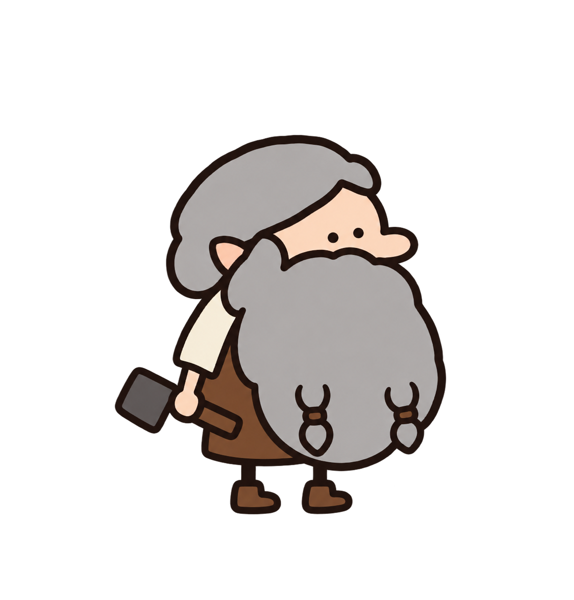
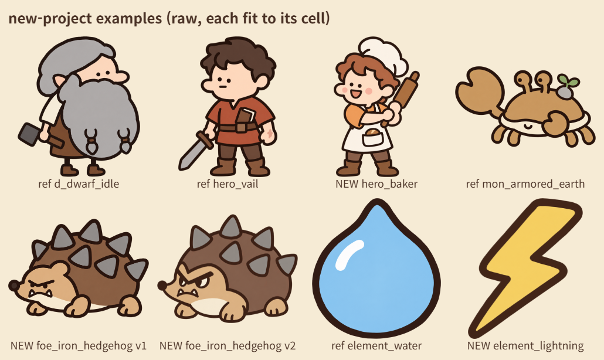
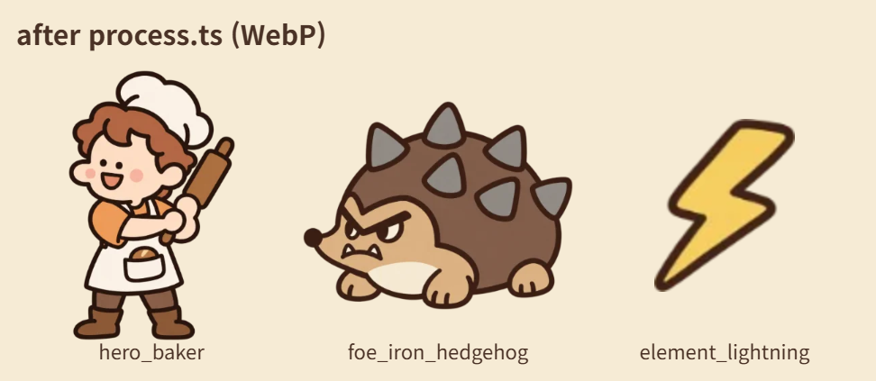

# 낙서풍(D 화풍) 아트 스타일 가이드

Codex CLI의 이미지 생성으로 「용사의 대장간」(임시 제목)의 그림체를 다른 프로젝트에서도 똑같이 뽑기 위한 문서다.
2026-10-11~14에 이 게임의 그림 222장(매니페스트 204장, 적다운 몬스터 12장, 대형 보스 6장)을 뽑았다. Codex가 생성한 그림은 버린 판과 시험을 합쳐 약 660장이다.
그때 쓴 지시문, 프롬프트, 참조 그림, 후처리, 검수 방법과 배운 것을 모두 여기에 모았다.

**키트에 같이 있는 것**

| 파일 | 내용 |
|---|---|
| `README.md` | 키트 소개, 새 프로젝트에 넣는 법, 5분 시작 |
| `ART_STYLE_GUIDE.md` | 이 문서. 화풍, 지시문, 범주별 템플릿, 참조, 크기, 후처리, 검수, 교훈 |
| `PROMPTS.md` | 이 게임에서 실제로 쓴 프롬프트 전부 (그림마다 마지막 판, 크기·투명·참조·메모 포함) |
| `ref/` | 화풍 기준 그림 `d_dwarf_idle.png`와 범주마다 세트의 기준 그림 |
| `tools/` | 스크립트 (npm 패키지 없음: Node, 헤드리스 크롬, Codex CLI). `init.ts` 프로젝트 파일 만들기, `manifest.ts` 화풍 문장·도움 함수·예제, `gen.ts` 뽑기, `inspect.ts` 원본 검사, `sheet.ts` 비교 시트, `process.ts` 다듬기 |
| `samples/` | 지금 그림을 모은 시트 (비교용), 새 프로젝트에서 키트만으로 뽑아 본 예 (`samples/new-project-examples/`, 9.8) |

새 프로젝트의 그림 목록은 키트 안이 아니라 키트 폴더 옆의 **프로젝트 파일**(`art-assets.ts`, `node tools/init.ts`가 만든다)에 적는다 (`README.md`, 9.3).

**읽는 법**

- 프롬프트는 Codex에 영어로 보냈다. 이 문서도 프롬프트는 영어 원문 그대로 코드 블록에 둔다. 코드 블록 안의 문장은 `tools/art/assets.ts`(이 게임의 매니페스트)와 생성 기록에서 기계적으로 옮겼다.
- 템플릿에서 `{{...}}`는 채울 자리다. `{{STYLE}}` 줄에는 2.1의 화풍 머리말을 그대로 넣는다.
- "첫 참조", "두 번째 참조"는 `codex exec`에 `-i`로 붙이는 그림의 순서다. 프롬프트가 "the first attached image", "the second attached image"라고 부르는 것과 순서가 같아야 한다.
- 날짜는 한국 시간이다.
- **한 범주만 뽑을 때는 다 읽지 않아도 된다**: 0장 → 2.6(조립 순서), 2.7(지시문) → 3장의 그 범주 절 → 7.2(체크리스트), 틀리면 7.4. 어느 절인지는 `README.md`의 '범주별 빠른 길' 표나 3장 머리의 표.
  새 프로젝트에서 처음부터 끝까지 해 본 예는 9.8에 있다.

## 목차

0. [한눈에](#0-한눈에)
1. [화풍](#1-화풍)
2. [지시문: 그대로 복사해 쓰는 문장](#2-지시문-그대로-복사해-쓰는-문장)
3. [범주별 템플릿](#3-범주별-템플릿)
4. [참조 그림 전략](#4-참조-그림-전략)
5. [크기, 투명, 파일 이름](#5-크기-투명-파일-이름)
6. [후처리](#6-후처리)
7. [검수와 자주 틀리는 것](#7-검수와-자주-틀리는-것)
8. [이 게임에서 겪은 일](#8-이-게임에서-겪은-일)
9. [새 프로젝트에서 시작하기](#9-새-프로젝트에서-시작하기)

---

## 0. 한눈에

**화풍 다섯 줄**

1. 굵고 살짝 삐뚤한 **짙은 갈색 마커 외곽선**이 모든 도형을 두른다. 그림 크기에 비해 굵다.
2. **평면 채색**: 부분마다 한 색. 음영, 그라데이션, 질감, 광택, 빛 번짐이 없다.
3. **디테일이 아주 적다.** 둥글고 뭉툭한 큰 모양 몇 개, 속 선은 한두 줄. "1분 만에 그린 귀여운 낙서".
4. **하찮고 귀엽다** (한국 밈 '하찮다'): 점 눈 둘, 작은 입, 표정 하나. 사람은 2~2.5등신.
5. **따뜻하고 살짝 누른 색**: 크림, 따뜻한 갈색, 부드러운 회색, 부드러운 주황.



*기준 그림 `ref/d_dwarf_idle.png` (1227×1282, 투명). 모든 그림이 이 드워프의 선과 채색을 따른다.*

지금 그림 전체는 `samples/`의 시트에 범주별로 모여 있다: `heroes.png`, `monsters_cute.png`, `monsters_enemy_bosses.png`, `icons.png`, `items.png`, `ui.png`, `cards.png`, `workshop.png`, `town.png`. 새 그림을 볼 때 옆에 두고 비교한다.

**가장 중요한 규칙 셋**

1. **모든 그림은 화풍 머리말(STYLE, 2.1)로 시작하고, 첫 참조는 늘 `d_dwarf_idle.png`다.**
   드워프가 나오지 않는 아이콘, 건물, 몬스터도 그렇다. 그리고 "드워프는 화풍 참조일 뿐이니 그리지 마라"(2.2)를 꼭 적는다.
2. **같은 세트에서 먼저 뽑아 고른 '기준 그림'을 두 번째 참조로 붙인다.**
   선 굵기, 틀 안의 크기와 여백, 시점이 세트 안에서 맞는다. 기준 그림 자신은 드워프만 참조로 뽑는다 (4장).
3. **한 번에 한 장만 뽑고, 뽑은 그림을 모두 눈으로 본다.**
   틀리면 무엇이 틀렸는지 끝 문단(`IMPORTANT ...`)으로 더해 다시 뽑는다. 앞 문단은 그대로 둔다 (7장).

**한 장이 만들어지는 길**

```text
매니페스트 항목 (키, 그룹, 크기, 투명, 참조, 프롬프트)
   │  뽑기: codex exec 한 번 = 그림 한 장 (1~3분)
   ▼
원본 PNG  raw/<그룹>/<키>.png
   │  눈으로 검수: 기준 드워프·세트 기준 그림과 나란히, 게임 크기로
   │  틀림 → <키>.rejected<n>.png로 남기고 끝 문단을 더해 다시 뽑기
   ▼
다듬기: 알파 정리, 여백 자르기, 긴 변 줄이기, WebP, meta.json
   ▼
게임 화면이나 비교 시트에서 다시 확인
```

---

## 1. 화풍

### 1.1 한 줄 정의

**"굵은 짙은 갈색 마커 선, 평면 채색, 아주 적은 디테일, 하찮고 귀여운 표정. 1분 만에 그린 귀여운 낙서처럼."**

- '하찮다'는 한국 인터넷 밈의 말이다. 보잘것없고 어설퍼서 오히려 귀여운 느낌을 뜻한다.
  프롬프트에서는 `cute and silly (the Korean "hachanhan" meme vibe)`, `SILLY, HUMBLE and a bit pathetic-cute`, `comic deadpan expression`, `Looks like a cute doodle drawn in a minute`로 적었다.
- 사용자가 고른 말 (2026-10-12): "조금 더 하찮은! 디테일을 줄이고 코믹스럽게."
- 이 게임의 문장 톤 '따뜻하고 하찮게'가 이 그림체에 맞춰져 있다. 무섭거나 진지한 그림은 이 화풍이 아니다.

### 1.2 선

- 색: 거의 검정에 가까운 짙은 갈색. 기준 드워프의 실측 평균은 `#21120d`다. 프롬프트에서는 `dark brown`, `near-black brown`.
- 모양: 손으로 그은 듯 살짝 고르지 않다 (`slightly uneven hand-drawn`). 굵기는 대체로 일정하다.
- 모든 도형에 선을 두른다: 다리, 눈자루, 집게, 불꽃, 연기 덩어리, 반짝이까지.
- 속 선은 부분의 경계를 나눌 때만 그린다. 한 부분 안에 한두 줄까지 (`at most one or two inner lines`).

**실측 굵기** (짙은 외곽선 픽셀이 가로·세로로 이어지는 길이의 중앙값):

| 그림 | 캔버스 | 선 굵기 | 물체 폭에 대한 비율 | 게임에서의 크기 |
|---|---|---|---|---|
| 기준 드워프 | 1227×1282 | 약 19px | 약 2.7% | 공방 장면에서 크게 |
| 용사 (바일) | 1024×1536 | 약 22px | 약 3% | 용사 카드, 전투 |
| 귀여운 몬스터 (고블린) | 1024×1024 | 약 15px | 약 2.3% | 전투에서 용사 키의 0.65배 |
| 적다운 몬스터 (엄니 오크) | 1024×1024 | 약 14px | 약 1.6% | 전투 |
| 대형 보스 (오우거) | 1024×1536 | 약 11px | 약 1.1% | 전투에서 용사 키의 2.2~2.6배 |
| 아이콘 (물 속성) | 1254×1254 | 약 57px | 약 6.6% | 화면에서 20~32px |

**원칙: 화면에 보이는 크기에서 선 굵기가 비슷해야 한다.** 작게 쓰는 그림일수록 원본의 선이 물체에 비해 굵어야 한다.
Codex는 물체 크기와 상관없이 비슷한 펜으로 그리는 버릇이 있다. 작은 소품을 캔버스에 꽉 차게 그리면, 장면 크기로 줄였을 때 선이 드워프보다 가늘어진다.
그래서 소품은 캔버스의 절반쯤으로 작게 그리라고 시켰다 (7.4의 1번).

### 1.3 채색

- 부분마다 평면 한 색 (`flat colors`, `one flat color per part`).
- 금지: 음영, 그라데이션, 질감, 하이라이트, 광택, 발광 (`NO shading, NO gradients, NO texture, NO highlights`, `no glow`, `no glossy shine`).
- 반짝임은 빛이 아니라 작은 네 꼭지 별 표시로 그린다 (`one tiny sparkle ... a tiny simple four-point star`).
- 불꽃도 평면이다: 주황 바깥 불꽃 + 노랑 속 불꽃 두 겹, 각각 외곽선.
- 바닥 그림자: 캐릭터, 몬스터, 소품, 아이콘에는 없다 (`no ground, no floor shadow`). 마을 지도의 건물·소품만 오른쪽 아래에 평면 회색 그림자 한 덩이를 허락했다.
- 같은 색 위에 같은 색을 놓으면 사라진다 (회색 바탕의 회색 목도리). 명도를 확실히 다르게 시킨다.

### 1.4 모양과 디테일

- 둥글고 뭉툭하고 통통하다 (`simple round chunky shapes`, `toy-like`).
- 가는 물건도 굵게 그린다: 활대, 지팡이 자루, 칼날 너비를 비율로 적는다 (7.4).
- 디테일은 슬금슬금 늘어난다. 그릴 것만 적지 말고 **그리지 말 것을 이름으로 적는다**: 나뭇결, 리벳, 바늘땀, 근육선, 털 가닥, 벽돌 수십 개, 이끼 스무 개.
- 글자, 숫자, 서명, 워터마크가 없다. 간판은 그림 기호만 쓴다.

### 1.5 캐릭터의 비례와 방향

| 종류 | 등신 | 머리 | 얼굴 | 몸·팔다리 | 방향 |
|---|---|---|---|---|---|
| 기준 드워프 | 약 2 | 회색 머리 덩어리, 수염이 몸 대부분을 덮는 큰 둥근 덩어리 (끝에 땋은 두 가닥) | 점 눈 둘, 큰 둥근 코, 뾰족한 귀 | 막대 같은 작은 팔다리, 작은 갈색 부츠, 갈색 앞치마, 크림색 셔츠 | 오른쪽 옆모습 (살짝 3/4) |
| 용사 | 2.3~2.5 (성격상 예외라도 3을 넘지 않게) | 키의 약 40%. 머리카락은 큰 덩어리 한두 개, 속 선 두 줄까지 | 점 눈(또는 선 눈) 둘 + 작은 입, 표정 하나 | 튜브 팔다리, 벙어리장갑 손, 작은 부츠, 옷은 평면 색 덩어리 몇 개 | **왼쪽**으로 3/4 |
| 귀여운 몬스터 | 약 2 | 둥근 덩어리 | 점 눈, 작은 입, 무섭지 않은 표정 | 짧고 뭉툭, 날카로운 것 없음 | **왼쪽**으로 3/4 |
| 적다운 몬스터 | 2~2.5 | 둥근 덩어리 | 찌푸린 눈썹, 가는 눈, 작은 송곳니 | 뭉툭한 가시, 손에 든 무기, 웅크리거나 덤비는 자세 | **왼쪽**으로 3/4 |
| 대형 보스 | 약 4 | **작은** 머리 | 화난 표정 (뒤에 '살짝 멍청하게' 고친 것도 있다) | 큰 몸, 넓은 어깨, 굵은 팔다리 | **왼쪽**으로 3/4 |

- 방향을 하나로 정해 모든 프롬프트에 적는다. 이 게임은 용사와 몬스터를 모두 왼쪽을 보게 그렸다. 전투에서 왼쪽에 서는 용사는 게임이 좌우를 뒤집는다.
  기준 드워프만 오른쪽을 본다.
- "왼쪽"은 그림의 왼쪽 가장자리다: `body and face turned three-quarters toward the LEFT edge of the image`. 첫 용사들이 오른쪽을 봐서 다시 그렸다.

### 1.6 팔레트

프롬프트에 hex를 `(#8ec8ee)`나 `(like #F2B279)`처럼 적으면 꽤 따라온다. 정확히 같지는 않으므로 꼭 맞아야 하는 색(카드 배경)은 후처리에서 바꾼다 (6.2).

| 쓰임 | 색 | 어디에 | 프롬프트의 말 |
|---|---|---|---|
| 외곽선 | `#21120d` (실측) | 모든 그림 | `dark brown`, `near-black brown` |
| UI 선·글자 | `#3b2a20` | CSS `--dd-ink` | |
| 크림 | `#f6ebd5` | 옷, 껍데기 테, 배, UI 종이 (`--dd-paper`) | `plain cream (#f6ebd5)` |
| 크림 흰색 | `#fbf7ef` | 토끼 아이콘, 흰 진화 카드 | `cream white (#fbf7ef)` |
| 피부 | `#fbd5bb` (드워프 실측) | 사람 | (적지 않아도 이 색이 나온다) |
| 부드러운 회색 | `#aeaaa8` (드워프 수염 실측) | 머리카락, 수염 | `soft grey`, `grey hair blob` |
| 쇠 회색 | `#8e8984` | 냄비 투구, 쇠붙이 | `plain grey #8e8984` |
| 돌·칼날 회색 | `#b3aea8`, `#c9c9cf` | 돌, 칼날 | `plain flat light grey blade (#c9c9cf)` |
| 따뜻한 밝은 회색 | `#cfc8c0` | 무속성 보스의 몸 | `warm light grey #cfc8c0` |
| 짙은 회색 | `#6b6461` | 연기, 속, 가마솥 | `warm dark grey #6b6461` |
| 갈색 | `#7a4c2f` (앞치마 실측), `#8a5a3a` | 가죽, 손잡이, 끈 | `brown (#8a5a3a)` |
| 나무 갈색 | `#a8703e`, UI 나무 바닥 `#876045` | 활, 화면 바탕 (`--dd-wood`) | |
| 주황 | `#f2a65a` | 불꽃 바깥, 주 버튼 (`--dd-orange`) | `flat warm orange (#f2a65a)` |
| 버터 노랑 | `#f3d36a` | 속 불꽃, 칼 코등이, 왕관 (`--dd-butter`) | `butter yellow (#f3d36a)` |
| 금 | `#f6c945` | 금별 (`--dd-gold`) | `bright warm gold (#f6c945)` |
| 빨강 계열 | `#e46f5a`, `#ea8a7e`, `#c9614a` | 과녁, 하트, 깃털 장식 | `soft red (#e46f5a)` |
| 이끼·풀 | `#8fae6b` | 새싹, 이끼, 연잎 | `moss-green (#8fae6b)` |
| 하늘·구름 | `#cfe3ea`, `#f7f9fa`, `#dce4ea` | 마을 지도의 하늘 | |

**속성 색** (몬스터 몸, 아이콘. 표식도 정해 두었다):

| 속성 | 몸 색 | 짙은 색 (날개 등) | 머리 위 표식 |
|---|---|---|---|
| 물 | `#8ec8ee` soft sky blue | `#6fa9cf` | 통통한 물방울 `#d4ecf9` |
| 불 | `#e8875a` soft red-orange | `#c96a43` | 작은 평면 불꽃 `#f2a65a` + 속 `#f3d36a`, 발광 없음 |
| 땅 | `#c9995f` warm ochre brown | `#a8774e` | 둥근 회색 조약돌 `#b3aea8` + 두 잎 새싹 `#8fae6b` |
| 바람 | `#bfe6d2` pale mint | `#8fcab0` | 청록 소용돌이 `#5fa8a0` (외곽선 없는 선) |

**새 속성이나 새 색을 더할 때** (이 게임에는 넷뿐이었다)

- 먼저 이미 쓴 색과 겹치는지 본다. 위의 속성 색과 표식 색, 그리고 버터 노랑 `#f3d36a`(불의 속 불꽃, 칼 코등이), 금 `#f6c945`(금별), 주황 `#f2a65a`(불꽃 바깥, 주 버튼)는 이미 뜻이 있다.
  같은 세트(속성 아이콘, 몬스터 몸 색)에서 색만으로 구별해야 하는 것끼리는 색상(hue)을 확실히 다르게 고른다.
- 겹쳐도 되는 경우: **모양이 확실히 다르고 세트 안에서 색으로 구별할 일이 없을 때.** 9.8의 번개 아이콘은 버터 노랑 `#f3d36a`(불의 속 불꽃과 같은 색)로 뽑았는데,
  32px로 줄여 물방울·엇갈린 검 옆에 놓아도 모양으로 바로 읽혔다. 다만 몬스터 몸 색처럼 넓은 면에 쓰면 불 속성의 속 불꽃·금별과 섞여 보일 수 있다.
  그때는 레몬 쪽 `#f7e27a`처럼 명도·채도를 조금 옮기거나, 속성 색을 다른 색상(예: 연보라)으로 정한다. 정한 hex는 이 표처럼 적어 두고 모든 프롬프트에서 되풀이한다.
- 색 하나를 정하면 짙은 색(날개 등)과 머리 위 표식(평면 기호 하나, 외곽선 포함)도 같이 정한다. 표식은 작게 읽히는 단순한 모양 하나가 좋다 (물방울, 불꽃, 조약돌+새싹).

**속성이 없는 게임**: 몬스터의 생김새에서 `Element mark: ...` 문장을 빼면 된다 (표식 없이 나온다).
같은 종의 색 변형(3.3 (나))은 공통 문단 `MON_SAME_SPECIES`가 "the one small element mark on top"을 말하므로, 생김새 끝에
`No element mark: remove the mark shown on top of the second image, and do not add any other mark.`처럼 적는다 (이 게임에서는 시험하지 않은 문장이다).
적다운 몬스터는 `FOE_SAME_BODY`가 "element color"를 말하므로 `foe(..., { secondRef: 'style' })`를 쓴다 (3.5).

**카드와 등급의 바탕색**:

| 무엇 | 색 |
|---|---|
| 카드 일러스트 바탕 (종류마다 평면 한 색) | 공정 `#F2B279`, 품질 `#BFDDEB`, 보조 `#CBE6C1`, 각인 `#D8CBEA`, 재료 `#F3DC8F`, 전설 `#E9C46A` + 누른 보라 원 |
| 별 문양 | 동 `#c98a55`, 은 `#c9cdd6`, 금 `#f6c945`, 달 `#f5e3a0`, 해 `#f29a3f` + 햇살 `#f6c945` |
| 진화 색 (용사 카드 바탕, CSS) | 보라 `#c9b3ee`, 금 `#f6d36a`, 빨강 `#ef8f7a`, 흰 `#fbf7ef` |

새 프로젝트에서 색을 바꾸고 싶으면 STYLE은 그대로 두고, 본문에 새 hex를 적는다 (9.4).

### 1.7 이 화풍이 아닌 것

화풍을 고를 때 버린 후보다. 원문 프롬프트는 `PROMPTS.md`에, 후보 그림을 모은 시트는 `samples/style_candidates.png`에 있다.

| 후보 | 생김새 | 버린 까닭 |
|---|---|---|
| v1 페인터리 | 슬레이 더 스파이어식 붓질, 림 라이트, 진지한 분위기 | 사용자: "그리고 캐릭터의 그림체는 조금 더 카툰스럽고 sd캐릭스러운 느낌을 원했어. 지금은 너무 진지한 그럼체야." |
| A 모바일 RPG 치비 | 2.5등신, 셀 채색 그림자 한 단계, 큰 눈 | 셋 모두에 사용자: "조금 더 하찮은! 디테일을 줄이고 코믹스럽게.다시 후보를 줘봐" |
| B 페인터리 카툰 | 3등신, 붓 외곽선, 림 라이트 | (위와 같음) |
| C 수채 애니 치비 | 가는 색 선, 수채 음영 | (위와 같음) |
| E 동글 마스코트 | 1.8등신 달걀 몸, 그림자 한 단계, 스티커 느낌 | D를 골랐다 |
| F 웹툰 치비 | 눈썹이 눈을 가림, 엷은 음영 | D를 골랐다 |
| G 크레파스 낙서 | 크레파스 질감, 흔들리는 선 | D를 골랐다 |
| **D 낙서 (채택)** | 2등신, 수염 덩어리, 점 눈, 막대 팔다리, 음영 없음 | 사용자: "D 로 해봐줘." 다음 날 "1.지금 아트 매우 좋아. 앞으로 만드는것들은 다 지금 아트 기준으로 만들어주면 될거같아." |

한 줄로: **셀 음영, 붓질, 수채, 크레파스 질감, 큰 반짝이는 눈, 4등신이 넘는 일러스트 비례는 모두 이 화풍이 아니다.**

### 1.8 UI (CSS 쪽)

그림이 아닌 UI(패널, 버튼, 막대)는 CSS로 같은 결을 낸다. 이 게임의 `src/ui/app.css` 토큰이다.

| 토큰 | 값 | 쓰임 |
|---|---|---|
| `--dd-ink` | `#3b2a20` | 선, 종이 위 글자 |
| `--dd-ink-soft` | `#7a6352` | 종이 위 조용한 글자 |
| `--dd-paper` / `-2` / `-3` | `#f6ebd5` / `#eadbbd` / `#fff8ea` | 패널, 눌린 칸, 안쪽 |
| `--dd-wood` / `-2` / `-3` | `#876045` / `#6f4c35` / `#5a3d2b` | 화면 바탕(공방 바닥과 같은 색), 띠 |
| `--dd-orange` / `--dd-sky` / `--dd-butter` / `--dd-red` / `--dd-green` / `--dd-gold` | `#f2a65a` / `#8ec8ee` / `#f3d36a` / `#e46f5a` / `#8cc47a` / `#f6c945` | 막대, 버튼, 표시 |
| `--dd-stroke` / `--dd-stroke-fat` | `2.5px` / `3px` | 패널·버튼의 선 |
| `--dd-round` / `--dd-round-s` | `16px` / `11px` | 모서리 |
| `--dd-pop` / `--dd-pop-s` | `0 3px 0 var(--dd-ink)` / `0 2px 0 var(--dd-ink)` | 딱딱한 그림자: 스티커가 그림자에서 살짝 비켜 앉은 모양 |
| `--dd-font-round` | `'Jua', ...` | 이름, 숫자, 제목 |
| `--dd-font-body` | `'Gowun Dodum', ...` | 읽는 글 |

글꼴은 Google Fonts에서 불러온다: `https://fonts.googleapis.com/css2?family=Gowun+Dodum&family=Jua&display=swap`.
다른 게임의 화면 예시를 받았을 때는 "그림체 말고 기능만" 따랐다 (사용자). 배치와 기능만 가져오고 그림은 늘 낙서풍으로 새로 그렸다.

---

## 2. 지시문: 그대로 복사해 쓰는 문장

### 2.1 화풍 머리말 (STYLE)

모든 그림의 프롬프트 맨 앞에 붙는다. 이 문장은 바꾸지 않는다.

```text
Super simple flat doodle cartoon in EXACTLY the same style as the attached dwarf character image: thick, slightly uneven hand-drawn dark brown outlines, flat colors, NO shading, NO gradients, NO texture, NO highlights, very few details, simple round chunky shapes, cute and silly (the Korean "hachanhan" meme vibe), warm cozy palette (cream, warm brown, soft grey, soft orange, a little muted). No text, no letters, no numbers, no watermark, no signature.
```

- "the attached dwarf character image"라고 부르므로 **첫 참조는 늘 `ref/d_dwarf_idle.png`**여야 한다.
- 괄호 안의 팔레트(cream, warm brown, soft grey, soft orange)는 이 게임의 따뜻한 색이다. 예제 용사 10명은 괄호 목록과 'no signature'를 뺀 판(HERO_STYLE)으로 뽑았다. 옷 색이 다양한 그림이나 따뜻한 색이 맞지 않는 세트에 쓸 수 있다:

```text
Super simple flat doodle cartoon in EXACTLY the same style as the attached dwarf character image: thick, slightly uneven hand-drawn dark brown outlines, flat colors, NO shading, NO gradients, NO texture, NO highlights, very few details, simple round chunky shapes, cute and silly (the Korean "hachanhan" meme vibe), warm cozy palette (a little muted). No text, no letters, no numbers, no watermark.
```

### 2.2 "드워프는 화풍 참조일 뿐" 안내

첫 참조가 드워프이므로, 드워프가 나오지 않는 그림에는 이 안내를 꼭 넣는다. 빼면 Codex가 드워프를 그려 넣거나 드워프 쪽으로 디자인을 끌고 간다.

**UI, 아이템, 아이콘, 소품, 건물** (STYLE_REF_ONLY):

```text
The first attached image (a doodle dwarf character) is a STYLE REFERENCE ONLY: copy its drawing style exactly (same thick dark brown outline weight, flat fills, tiny amount of detail), but do NOT draw the dwarf or any person; draw only what is asked below.
```

**사람 캐릭터, 참조 한 장** (HERO_REF_NOTE):

```text
The attached image is our dwarf blacksmith and is a STYLE REFERENCE ONLY: copy its drawing style exactly (same thick dark brown outline weight, same flat fills, same tiny amount of detail, same two dot eyes, same simple stick-like arms and legs and little boots), but do NOT draw the dwarf. Draw only the new character described below.
```

**사람 캐릭터, 두 번째 참조로 세트 기준 용사를 붙일 때** (명단 용사 마지막 묶음의 안내):

```text
The first attached image is our dwarf blacksmith and is a STYLE REFERENCE ONLY: copy its drawing style exactly (same thick dark brown outline weight, same flat fills, same tiny amount of detail, same two dot eyes, same simple stick-like arms and legs and little boots), but do NOT draw the dwarf. The second attached image is another hero from the same game: match its proportions (about 2.3 to 2.5 heads tall, a big round head), its outline thickness, its flat fills, its small amount of detail and how large the character sits in the frame exactly, but do NOT draw that hero (no red tunic, no ledger, no sword unless asked). Draw only the new character described below.
```

**몬스터** (MON_REF_NOTE):

```text
The first attached image is our dwarf blacksmith and is a STYLE REFERENCE ONLY: copy its drawing style exactly (same thick dark brown outline weight, same flat fills, same tiny amount of detail, same two dot eyes), but do NOT draw the dwarf or any person. Draw only the monster described below.
```

### 2.3 두 번째 참조(세트 기준) 안내

두 번째 참조가 무엇이고, 무엇을 맞추고, 무엇을 그리지 말지를 적는다. 꼴은 늘 같다:
"The second attached image is {{무엇}} from the same {{세트}}. Match it exactly in {{맞출 것}}. Do NOT redraw {{그것}}; draw only the new {{것}} described below."

**아이콘 세트** (ICON_SAME_SET):

```text
The second attached image is another icon from the same game UI icon set. Match it exactly in drawing style, outline weight and how big the shape sits in the frame (same scale and margin, centered), so all the icons look like one set. Do NOT redraw that icon; draw only the new icon described below.
```

**아이템 아이콘 세트** (SAME_ITEM_SET, 기준은 철광석):

```text
The second attached image is an item icon from the same set (iron ore). Match it exactly in drawing style, outline weight and how big the object sits in the frame (same scale and margin, centered), so the icons look like one set. Do NOT redraw the iron ore; draw only the new object described below.
```

**UI 버튼 세트** (SAME_UI_SET):

```text
The second attached image is an existing button from the same game UI. Match its very fat, crisp dark brown outline, its flat warm light grey fill and its little flat orange flame marks, so it looks like the same UI set. Do NOT redraw that button; draw only the new object described below.
```

**같은 종의 몬스터, 색과 표식만 바꿀 때** (MON_SAME_SPECIES):

```text
The second attached image is the SAME monster species already drawn in another element color. Draw the SAME creature: same silhouette, same pose, same proportions, same face and expression, same size and position in the frame and the same outline weight. Change ONLY the main body color (and its matching darker shade, if any) and the one small element mark on top, which replaces the mark shown in the second image, as described below.
```

**마을 지도 건물** (TOWN_SAME_FORGE):

```text
The second attached image is the forge building from the same village map set. Match it exactly: the same 3/4 top-down camera angle, the same thick dark brown outline weight, the same flat fills and palette, the same small amount of detail, and the same scale (a door of the same size, so the buildings line up on one map). Do NOT redraw the forge; draw only the new object described below.
```

**적다운 몬스터** (3.5): 같은 체형·속성의 귀여운 몬스터를 붙일 때는 "The second attached image is one of our existing cute monsters of the same body type and element"로 시작하는 문단(FOE_SAME_BODY, 3.5의 템플릿에 전문)을 쓴다.
새 프로젝트에 맞는 귀여운 몬스터가 없어 다른 몬스터를 화풍 기준으로만 붙일 때는 아래 문단(FOE_STYLE_REF)을 쓴다.
**이 문단은 키트에서 새로 쓴 것이다** (원래 게임에서 쓰지 않았다). 낱말은 대형 보스의 참조 문단(BIG_BOSS_SCALE)에서 가져왔고, 2026-10-14에 한 번 뽑아 확인했다 (9.8의 고슴도치 둘째 판).

```text
The second attached image is an existing monster from the same game: use it ONLY as a reference for the drawing style, the flat coloring, the thick dark brown outline weight, the level of detail and the size in the frame. Do NOT copy its species, body, colors or marks: draw the new creature described below, in the colors described below.
```

### 2.4 카드 일러스트 구도 (CARD_FRAMING)

STYLE 다음, 장면 앞에 붙인다.

```text
Card illustration, square composition: one clear subject in the center with breathing room (it will be cropped to a 4:3 window, so keep everything important inside the central area), a single flat warm background color block (no scenery detail). Funny and charming.
```

### 2.5 투명, 여백, 불투명 문장

**투명 물건, 여백** (ALPHA_MARGIN):

```text
Transparent background with a real alpha channel. The object is centered with a comfortable empty margin on every side; nothing is cut off at the edges.
```

**캐릭터·몬스터의 끝** (공통 문단에 들어 있다):

```text
The whole character fits inside the frame with empty margin on all sides, nothing cropped. Transparent background with a real alpha channel: no backdrop, no ground, no floor shadow.
```

**마을 지도 건물·소품의 끝** (TOWN_FRAME):

```text
Transparent background with a real alpha channel. The object is centered with a comfortable empty margin on every side; nothing is cut off at the edges. Signs carry only simple picture symbols, never letters or numbers.
```

**불투명 카드** (물건 카드):

```text
Opaque image: the flat background color fills the whole square edge to edge (not transparent, no white margin, no border).
```

### 2.6 프롬프트를 조립하는 순서

문단은 빈 줄 하나로 잇는다. 이 순서를 모든 범주에서 지켰다.

1. **화풍 머리말** STYLE (2.1)
2. **첫 참조 안내**: 드워프는 화풍만 (2.2)
3. **두 번째 참조 안내**: 세트 기준이 무엇이고 무엇을 맞추고 무엇을 그리지 말지 (2.3)
4. **세트 공통 문단**: 방향, 비례, 디테일의 양, 틀 안의 크기와 여백, 투명
5. **종류 문단** (있으면): 등급, 보스, 크기 줄
6. **본문**: 이 그림만의 생김새. 색은 hex로
7. **끝 문단** (다시 뽑을 때만): `IMPORTANT ...`로 시작해 첫 판에서 틀린 것만 고친다

이 게임에서 그룹마다 실제로 붙인 것:

| 그룹 | 최종 프롬프트 |
|---|---|
| 주인공 자세, 예제 용사 10명 | 프롬프트에 화풍이 들어 있다 (머리말을 따로 붙이지 않음) |
| 카드 일러스트 | STYLE + CARD_FRAMING + 장면 |
| UI, 정제 아이템, 아이콘 | STYLE + STYLE_REF_ONLY + [세트 안내] + [아이콘 틀] + 본문 |
| 장면 소품, 마을 지도, 명단 용사, 몬스터 | STYLE + (참조 안내, 세트 안내, 공통 문단, 본문을 담은) 프롬프트 |

### 2.7 Codex에 보내는 지시문 (표준 입력)

이미지 프롬프트를 이 지시문으로 감싸 `codex exec`의 표준 입력으로 보낸다.
이 게임의 `tools/art/gen.ts`가 보낸 것이고, 키트의 `tools/gen.ts`도 같은 지시문을 보낸다.

```text
Use your built-in image generation tool (image_gen) to create exactly ONE image, then save it as {{KEY}}.png in the current directory.
- Size: {{SIZE, 예: 1024x1536}} ({{square | landscape | portrait}}). If the tool has a size parameter, use this size or the closest supported one.
- Background: TRANSPARENT, a real alpha channel in a PNG, no backdrop at all. If the tool has a background parameter, set it to transparent.
- Attached reference images, in order: 1) {{REF1, 예: d_dwarf_idle}}, 2) {{REF2}}. Use them as the image prompt says.
- Generate once, then copy the generated file from where the tool saved it to ./{{KEY}}.png. Do not edit, crop, resize or post-process it, and do not create any other files.

Image prompt:
{{IMAGE PROMPT: 2.6의 순서로 조립한 전부}}

Reply with only the saved file path.
```

- 불투명 그림이면 배경 줄을 이것으로 바꾼다: `- Background: a fully painted, opaque image that fills the whole frame. No transparency.`
- 참조가 한 장이면: `- Attached reference image: 1) d_dwarf_idle. Use it as the image prompt says.`

줄마다 까닭이 있다:

| 줄 | 까닭 |
|---|---|
| `built-in image generation tool (image_gen)` | Codex가 내장 도구를 쓰게 한다. Codex의 이미지 스킬에는 OPENAI_API_KEY가 드는 다른 길이 있는데, 이름을 적어 그 길로 새지 않게 했다. |
| `exactly ONE image`, `Generate once` | Codex가 자기 결과를 보고 다시 그려 약 50초 뒤 파일을 덮어쓴 적이 있다. 한 번만 그리게 한다. |
| `copy the generated file ... Do not edit, crop, resize` | 내장 도구는 늘 `~/.codex/generated_images/<세션>/`에 저장하고 저장 위치를 받지 않는다. Codex가 그 파일을 복사해 오게 하고, 손대지 못하게 한다. |
| `If the tool has a size parameter ... closest supported one` | 정사각 1024를 시키면 1254×1254로 낼 때가 많다. 크기는 후처리에서 맞춘다 (5.1). |
| 배경 줄 | 투명은 이미지 프롬프트와 지시문 두 곳에서 부탁한다. 그러면 늘 진짜 알파가 나왔다. |
| `Reply with only the saved file path.` | 답을 짧게 해 로그를 읽기 쉽게 한다. |

**실제로 보낸 전문의 예** (전투 UI의 '빠름' 상태 아이콘, 참조: d_dwarf_idle, 물 속성 아이콘):

```text
Use your built-in image generation tool (image_gen) to create exactly ONE image, then save it as status_fast.png in the current directory.
- Size: 1024x1024 (square). If the tool has a size parameter, use this size or the closest supported one.
- Background: TRANSPARENT, a real alpha channel in a PNG, no backdrop at all. If the tool has a background parameter, set it to transparent.
- Attached reference images, in order: 1) d_dwarf_idle, 2) icons/element_water. Use them as the image prompt says.
- Generate once, then copy the generated file from where the tool saved it to ./status_fast.png. Do not edit, crop, resize or post-process it, and do not create any other files.

Image prompt:
Super simple flat doodle cartoon in EXACTLY the same style as the attached dwarf character image: thick, slightly uneven hand-drawn dark brown outlines, flat colors, NO shading, NO gradients, NO texture, NO highlights, very few details, simple round chunky shapes, cute and silly (the Korean "hachanhan" meme vibe), warm cozy palette (cream, warm brown, soft grey, soft orange, a little muted). No text, no letters, no numbers, no watermark, no signature.

The first attached image (a doodle dwarf character) is a STYLE REFERENCE ONLY: copy its drawing style exactly (same thick dark brown outline weight, flat fills, tiny amount of detail), but do NOT draw the dwarf or any person; draw only what is asked below.

The second attached image is another icon from the same game UI icon set. Match it exactly in drawing style, outline weight and how big the shape sits in the frame (same scale and margin, centered), so all the icons look like one set. Do NOT redraw that icon; draw only the new icon described below.

A small game UI icon that must read clearly at 24px: one simple bold shape, centered, filling about three quarters of the square canvas with a comfortable empty margin on every side, nothing cut off. Transparent background with a real alpha channel: no backdrop, no badge or circle behind it, no ground shadow, no glow. Draw it with the same VERY fat, bold dark brown marker outline as the dwarf, one flat color per part (no lighter or darker patches, no shading, no gradient, no glossy shine), and at most one or two inner lines. No face.

Speed-up status icon: the round head of a little bunny seen from the front with two tall upright rounded ears, in one flat cream white (#fbf7ef) with soft pink (#f2b8b0) inner ears, and three short straight horizontal speed lines in flat warm orange (#f2a65a) trailing off its left side. Nothing else.

Reply with only the saved file path.
```

### 2.8 명령

```bash
codex exec --skip-git-repo-check -C <원본 폴더>/<그룹> -s workspace-write --color never \
  [-m <모델>] -i <첫 참조> -i <두 번째 참조> -- -
```

| 인자 | 까닭 |
|---|---|
| `-C <폴더>` | Codex의 작업 폴더. 그림을 여기에 `<키>.png`로 저장한다. |
| `-s workspace-write` | 작업 폴더에 파일을 쓸 수 있어야 한다. |
| `--skip-git-repo-check` | 원본 폴더는 git 밖에 있어도 된다. |
| `-i <그림>` | 참조 그림. 여러 번 쓰고, **쓴 순서가 곧 첫째·둘째다**. |
| `-- -` | `-i`가 값을 여러 개 받으므로 `--`로 끊고, `-`는 "프롬프트를 표준 입력에서 읽어라"다. |

- **표준 입력은 꼭 닫는다.** 프롬프트를 인자로 줄 때는 끝에 `< /dev/null`을 붙인다. 안 그러면 `Reading additional input from stdin...`에서 기다린다.
  한 번은 540초 동안 그림 없이 멈췄고, `while read` 반복 안에서는 남은 목록을 삼켰다.
- 손으로 부를 때 (Git Bash, 키트 폴더에서. `task.txt`는 2.7의 지시문 전문):

```bash
mkdir -p ../art-raw/icons
codex exec --skip-git-repo-check -s workspace-write -C ../art-raw/icons \
  -i ref/d_dwarf_idle.png -i ref/element_water.png -- - < task.txt
```

- 키트의 `tools/gen.ts`는 프롬프트를 표준 입력으로 보내고 닫는다. 손으로 부르기보다 도구를 쓰는 편이 안전하다 (참조 순서, 백업, 알파 확인을 해 준다).
  `node tools/gen.ts <그룹/키> --dry`로 실제로 보낼 명령과 표준 입력 전문을 미리 볼 수 있다.
- Codex는 한 번에 약 25KB를 출력한다. 대부분 이미지 스킬 설명이고, 그 안에 "OPENAI_API_KEY must be set" 같은 문장이 있다. 쓰지 않는 다른 길(CLI 대체 경로)의 이야기라 무시한다.
  키트의 `gen.ts`는 이 출력을 `<원본 폴더>/<그룹>/_logs/<키>-<시각>.log`에 남기고 화면에는 진행(30초마다)과 결과, Codex의 마지막 답, 토큰 수만 찍는다. 다 보려면 `--verbose`.
  실패하면 출력의 끝 20줄과 기록 파일 경로를 보여 준다.
- Windows: npm 전역 설치의 Codex는 `%APPDATA%\npm\node_modules\@openai\codex\bin\codex.js`다. 이 게임의 도구는 이것을 `node`로 바로 띄워 cmd.exe의 따옴표 문제를 피했다 (`CODEX_BIN` 환경 변수로 바꿀 수 있다).
  Git Bash에서 Codex에 절대 경로를 줄 때는 `cygpath -w`로 바꾸거나 상대 경로를 쓴다.

### 2.9 운영 수치

- **한 번에 한 장.** 한 호출에 여러 장을 시키지 않는다.
- 시간: 한 장에 약 50~170초. 62번을 재면 중앙값 99초였다. 검토까지 넣으면 한 장에 약 2분.
- 동시에 2~3개를 돌려도 됐다. 약 660장을 4일 동안 뽑는 동안 사용량 제한 오류가 없었다. 실패하면 60초 쉬고 다시 했다.
  **같은 폴더여도 된다**: Codex마다 자기 `<키>.png`만 쓴다. 이 게임도 용사들을 한 폴더(`roster/heroes`)에 2~3개씩 동시에 뽑았다 (파일 시각으로 확인).
  같은 키를 동시에 두 번 돌리지는 않는다 (백업과 결과 파일이 엇갈린다). 키트의 `gen.ts`는 `_logs/<키>.running` 표시 파일로 막는다 (15분 넘은 것은 남은 찌꺼기로 본다).
- 한 번에 약 17k 토큰을 쓴다 (대부분 Codex가 이미지 스킬 설명을 읽는 몫. 2026-10-14 키트 시험에서는 15~26k).
- Codex 계정에 로그인만 되어 있으면 된다 (`codex login`). OPENAI_API_KEY는 필요 없다.
  `codex features list`에서 `image_generation`이 켜져 있는지 본다.
- 이 게임은 codex-cli 0.162.0, 설정의 기본 모델(`gpt-6.1-sol`, reasoning medium)로 뽑았다. 버전이나 모델이 다르면 결과가 흔들릴 수 있으므로 새 환경에서는 시험 한 장부터 뽑는다 (9.2).
- **검토는 Codex 프로세스가 끝난 뒤에 한다.** 파일이 생긴 뒤 덮어써진 적이 있다.
- `~/.codex/generated_images/`는 저절로 지워지지 않는다. 이 게임 동안 PNG 663장, 675MB가 쌓였다. 가끔 정리한다.

### 2.10 이 문서의 이름과 키트의 이름

이 문서는 문단을 원래 게임의 이름으로 부른다. 키트의 `tools/manifest.ts`에는 같은 글자가 아래 이름으로 들어 있다 (글자는 같다).

| 이 문서 (원래 게임) | 키트 `tools/manifest.ts` |
|---|---|
| STYLE, STYLE_REF_ONLY, CARD_FRAMING, HERO_STYLE, HERO_REF_NOTE, HERO_COMMON, DWARF_SAME, SPECIAL_ONE_IDEA, NORMAL_TAIL, MON_REF_NOTE, MON_COMMON, MON_SAME_SPECIES, FLOOR_BOSS_NOTE, FLOOR_BOSS_FRAME, DAILY_BOSS_FRAME, ICON_SAME_SET, ICON_FRAME, SAME_ITEM_SET, SAME_UI_SET, ALPHA_MARGIN | 같은 이름 |
| 명단 용사 묶음 4의 참조 안내, 공통 문단 (`ROSTER_B4.ref`, `.common`) | `CHAR_REF`, `CHAR_COMMON` |
| 적다운 몬스터의 공통 문단, 두 번째 참조 안내 | `FOE_COMMON`, `FOE_SAME_BODY` |
| (없음: 키트에서 새로 쓴 문장, 2.3) | `FOE_STYLE_REF` (`foe(..., { secondRef: 'style' })`) |
| TOWN_SAME_FORGE, TOWN_SAME_TOWER, townSameSet | `BUILDING_SAME_SET`, `TOWER_SAME_SET`, `mapSameSet` |
| TOWN_VIEW_FORGE, TOWN_VIEW_TURNED, TOWN_VIEW_FRONT, TOWN_VIEW_MAP | `VIEW_TOPDOWN`, `VIEW_TOPDOWN_LIKE_REF`, `VIEW_FRONT`, `VIEW_MAP` |
| TOWN_FRAME | `MAP_FRAME` |
| TOWN_PROP_REF_ONLY, TOWN_PROP_SAME_TREE, TOWN_PROP_FRAMING | `PROP_REF_ONLY`, `PROP_SAME_SET`, `PROP_FRAMING` |

그룹 이름도 바뀌었다: scene → `objects`, heroes → `characters`, monsters → `monsters`, icons → `icons`, ui → `ui`, refine → `items`, cards → `cards`, town → `map`.
그룹마다 STYLE 뒤에 무엇을 붙일지(STYLE_REF_ONLY, CARD_FRAMING)는 원래 게임과 같은 규칙이다 (2.6).
그룹을 더하거나 규칙을 바꾸려면 키트를 고치지 않고 프로젝트 파일에 `export const PROJECT_GROUPS = { portraits: 'style' } as const;`처럼 적는다
(규칙은 `'style'`, `'style+refOnly'`, `'style+card'`).

새 프로젝트의 그림은 키트 폴더 옆의 프로젝트 파일(`art-assets.ts`)의 `PROJECT_ASSETS`에 적는다. 그 파일이 `tools/manifest.ts`의 도움 함수와 상수를 import해 쓴다.
도구는 키트 예제(`EXAMPLE_ASSETS`)와 프로젝트 그림을 함께 읽는다 (같은 `그룹/키`면 프로젝트 쪽).

---

## 3. 범주별 템플릿

범주마다 **언제 쓰나, 설정(크기·투명·참조·처리 크기), 템플릿, 이 게임의 실제 예, 주의**를 적었다.

- 템플릿은 그대로 복사해 `{{...}}`만 채운다. `{{STYLE}}` 줄에는 2.1을 넣는다.
- 예는 이 게임에서 채택한 판의 원문이다. 긴 것은 본문 문단만 보였다. 그림마다의 전체 프롬프트는 `PROMPTS.md`에 있다.
- 참조는 `첫 참조 → 두 번째 참조` 순서로 적었다. `@키`는 같은 세트에서 먼저 뽑은 그림이다.
- 키트의 `tools/manifest.ts`에는 범주마다 항목을 만드는 도움 함수가 있다. 함수가 STYLE과 공통 문단을 붙이므로 생김새(본문)만 적으면 된다.
  함수가 없는 범주(UI, 장면 소품)는 항목을 직접 적는다. 키트의 `EXAMPLE_ASSETS`에 범주마다 예가 있다.
  항목은 프로젝트 파일(`art-assets.ts`)의 `PROJECT_ASSETS`에 `...inGroup('icons', icon(...))`나 `{ ...icon(...), group: 'icons' }`로 적는다 (9.8에 실제 예).

| 범주 | 키트 그룹 | 키트 도움 함수 |
|---|---|---|
| 3.1 기준 캐릭터의 새 자세 | `characters` | `pose` |
| 3.2 사람 캐릭터: 세트의 첫 장 / 나머지 | `characters` | `leadCharacter` / `character` |
| 3.3 귀여운 몬스터 | `monsters` | `monster` (속성 변형은 `sameAs`) |
| 3.4 같은 종의 보스 / 화면을 채우는 보스 | `monsters` | `speciesBoss` / `screenBoss` |
| 3.5 적다운 몬스터 | `monsters` | `foe` (맞는 귀여운 몬스터가 없으면 `{ secondRef: 'style' }`) |
| 3.6 대형 보스 | `monsters` | `bigBoss` (트윈헤드·가고일 꼴. 오크 로드 꼴은 직접 적는다) |
| 3.7 얼굴 편집 | (매니페스트 밖, 손으로 부른다) | |
| 3.8 아이콘 | `icons` | `icon` |
| 3.9 아이템 아이콘 | `items` | `itemIcon` |
| 3.10 UI 그림 | `ui` | (직접) |
| 3.11 카드 일러스트 | `cards` | `card`, `cardBackground` |
| 3.12 장면 배경·소품·무기 | `objects` | (직접) |
| 3.13 마을 지도 | `map` | `building`, `prop` |

### 3.1 기준 캐릭터의 새 자세

**언제**: 기준 캐릭터(이 게임은 드워프)를 다른 자세로 그릴 때. 같은 캐릭터를 다시 디자인하지 않고 자세만 바꾼다.

**설정**: 캔버스는 기준 그림과 같게 (드워프는 1227×1282). 투명. 참조 `d_dwarf_idle` 하나. 처리 긴 변 900px.
화풍이 프롬프트 안에 들어 있어 STYLE을 따로 붙이지 않았다.

```text
The attached image is our {{CHARACTER, 예: dwarf blacksmith}} in the final art style. Draw the SAME character in EXACTLY the same style: super simple flat doodle, {{SIGNATURE FEATURES, 예: the grey beard is one big round blob with two tiny braids, grey hair blob, two dot eyes, small nose, tiny stick-like arms and legs, little brown boots, brown apron, cream shirt}}, uneven hand-drawn dark outline, flat colors, NO shading, NO extra detail. Same size and proportions (about {{N}} heads tall), {{VIEW, 예: side view facing right}}. Transparent background with a real alpha channel. No text. New pose: {{POSE}}
```

**예** (`scene/dwarf_strike`, 망치를 내려친 순간):

```text
The attached image is our dwarf blacksmith in the final art style. Draw the SAME character in EXACTLY the same style: super simple flat doodle, the grey beard is one big round blob with two tiny braids, grey hair blob, two dot eyes, small nose, tiny stick-like arms and legs, little brown boots, brown apron, cream shirt, uneven hand-drawn dark outline, flat colors, NO shading, NO extra detail. Same size and proportions (about 2 heads tall), side view facing right. Transparent background with a real alpha channel. No text. New pose: the moment right after a hammer blow, both tiny arms holding the hammer brought down in front of him at belly height (the hammer head is in front of the beard, as if it just hit an anvil top, do not draw the anvil), body leaning forward, eyes squeezed shut as two short lines.
```

**주의**

- 다섯 자세 모두 첫 판을 채택했다. `-i`로 붙인 기준 그림은 캐릭터와 화풍을 아주 잘 지킨다.
- "Same size"라고 적어도 자세마다 그림 안의 키가 흔들린다 (옛 화풍에서 16% 차이). 게임에서는 몸 높이(meta.json의 `trim.h`)로 맞춰 쓴다 (6.4).
- 그리지 않을 물건은 괄호로 막는다: `(the hammer head is in front of the beard, as if it just hit an anvil top, do not draw the anvil)`.

### 3.2 사람 캐릭터 (용사 세트)

**설정**: 1024×1536 세로, 투명. 처리 긴 변 400px.

#### (가) 세트의 첫 장 = 세트 기준

참조: `d_dwarf_idle` 하나. 이 그림을 가장 꼼꼼히 검수한다. 나머지가 모두 이 그림을 따른다.

```text
Super simple flat doodle cartoon in EXACTLY the same style as the attached dwarf character image: thick, slightly uneven hand-drawn dark brown outlines, flat colors, NO shading, NO gradients, NO texture, NO highlights, very few details, simple round chunky shapes, cute and silly (the Korean "hachanhan" meme vibe), warm cozy palette (a little muted). No text, no letters, no numbers, no watermark.

The attached image is our dwarf blacksmith and is a STYLE REFERENCE ONLY: copy its drawing style exactly (same thick dark brown outline weight, same flat fills, same tiny amount of detail, same two dot eyes, same simple stick-like arms and legs and little boots), but do NOT draw the dwarf. Draw only the new character described below.

Draw ONE human adventurer hero, full body from head to boots, standing, front three-quarter view: body and face turned slightly toward the LEFT edge of the image (the character looks toward the viewer's left). Chibi proportions about 2.3 to 2.5 heads tall (a little less squat than the dwarf: a big round head that is about 40% of the total height, small body). Very simple face: two dot eyes (or very simple line eyes) and a tiny mouth, the personality shown by the silhouette and ONE clear expression. Keep details minimal like the dwarf: hair is one or two big simple blob shapes with at most two inner lines, arms and legs are simple tubes, hands are simple mitten shapes, plain clothes made of a few flat color blocks, no patterns, no stitching, no ornaments beyond what is described. The whole character fits inside the frame with empty margin on all sides, nothing cropped. Transparent background with a real alpha channel: no backdrop, no ground, no floor shadow.

The hero: {{NAME}}, {{WHO: 나이·체격·성격 한 줄}}. {{HAIR: one simple blob}}. {{FACE: ONE clear expression}}. {{CLOTHES: 평면 색 덩어리, 대표 색은 hex}}. {{SIGNATURE PROP: 성격을 보여 주는 소품 하나}}. {{WEAPON + POSE}}.
```

**예** (`heroes/hero_vail`, 명단 용사 모두의 두 번째 참조. 둘째 판):

```text
The hero: Vail, a young man, the first hero who ever came to the forge. Broad square shoulders and a sturdy build, chibi 2.4 heads tall. Short dark brown hair as one simple tufty blob. Blunt but honest: a straight flat serious mouth and steady dot eyes, slight frown. Rust-red tunic (#b5523b), brown belt, brown trousers, little brown boots. A small worn brown ledger book tucked into the front of his tunic, its top corner sticking out. One old burn scar shown as a simple pale pink patch on the back of his right hand. He holds a plain one-handed sword (simple grey blade, brown grip) pointing down at his side.
```

#### (나) 세트의 나머지

참조: `d_dwarf_idle` → `@hero_vail` (세트 기준 용사).

```text
{{STYLE}}

The first attached image is our dwarf blacksmith and is a STYLE REFERENCE ONLY: copy its drawing style exactly (same thick dark brown outline weight, same flat fills, same tiny amount of detail, same two dot eyes, same simple stick-like arms and legs and little boots), but do NOT draw the dwarf. The second attached image is another hero from the same game: match its proportions (about 2.3 to 2.5 heads tall, a big round head), its outline thickness, its flat fills, its small amount of detail and how large the character sits in the frame exactly, but do NOT draw that hero (no red tunic, no ledger, no sword unless asked). Draw only the new character described below.

A hero character for the game: {{LOOK: 나이·체격, 머리, 표정, 옷 색, 대표 소품, 무기를 든 모양}}

Full body from head to boots, standing, body turned slightly to the left in a front 3/4 view (body and face turned slightly toward the LEFT edge of the image, looking toward the viewer's left). Chibi proportions about 2.3-2.5 heads tall (a big round head that is about 40% of the total height, small body). Very simple face: two dot eyes (or very simple line eyes) and a tiny mouth, the personality shown by the silhouette and ONE clear expression. Hair is one or two big simple blob shapes with at most two inner lines, arms and legs are simple tubes, hands are simple mitten shapes, plain clothes made of a few flat color blocks, no patterns, no stitching, no ornaments beyond what is described. Holding their weapon. Thick outlines, flat colors. The whole character fits inside the frame with wide empty margin on all sides (the character fills only the middle of the image, like the second reference), nothing cropped. Transparent background with a real alpha channel: no backdrop, no ground, no floor shadow. No text.

{{GRADE: 특별한 등급이면 아래 첫 문장, 평범한 등급이면 LOOK 끝에 아래 둘째 문장}}

{{EXTRA: 다시 뽑을 때만. 'Important: ...'}}
```

- 첫 문단의 `(no red tunic, no ledger, no sword unless asked)`는 이 게임의 기준 용사(바일)의 특징이다. 새 세트에서는 기준 그림의 대표 특징으로 바꾼다.
- 특별한 등급 (SPECIAL_ONE_IDEA):

```text
This is a special-rank hero: make the design a little more distinctive (one memorable silhouette idea), but keep it just as simple and doodle-like as the others.
```

- 평범한 등급 (NORMAL_TAIL, LOOK 끝에 붙인다):

```text
An ordinary common hero: plain and humble, simple clothes, nothing fancy.
```

**예, 특별 등급** (`heroes/hero_kio`, 첫 판 채택):

```text
A hero character for the game: A cheerful scrawny boy of about 14 with spiky light-brown hair and a wide open grin, in a leaf-green short tunic and rolled-up brown trousers. He raises a plain one-handed sword high, and a small four-blade paper pinwheel (plain mint and cream blades) sticks up from his headband.
```

**예, 평범한 등급과 다시 뽑을 때의 끝 문단** (`heroes/hero_som`, 둘째 판. 첫 판이 다른 용사와 실루엣이 거의 같았다):

```text
A hero character for the game: A gentle teenage apprentice healer girl with short light-brown hair and a soft smile, in a white dress with a short mint-green cape. She holds a simple wooden staff with one small green leaf on top, and a roll of white bandage hangs from her belt with one end trailing down. An ordinary common hero: plain and humble, simple clothes, nothing fancy.

Important: she must look clearly different from a brown-bob girl in a cream robe with a long green cape. Her memorable joke is that she wraps bandages TOO well: her own arm is wrapped in white bandage from wrist to shoulder, a strip of white bandage is tied around her head like a headband with a small bow knot on the side, and from the bandage roll on her belt one long loose white bandage end trails down to the ground in a few simple loops. Her hair: ONE simple rounded short light honey-brown blob with at most one inner line, NO strands, NO long side locks. Her cape is only a tiny round pale mint capelet that covers just her shoulders (not a long cape). Her white dress is short and plain. Gentle closed-eye smile (two small upward arcs and a tiny smile). Her head is about 40% of her height, not bigger, and she sits the same size in the frame as the second reference hero with wide empty margins.
```

**주의**

- 첫 판들이 2.8~4등신으로 나왔다. `about 40% of the total height`, `NOT bigger`를 적어 고쳤다.
- 틀을 꽉 채우면 세트 안에서 크기 비교가 안 된다: `the character fills only the middle of the image, like the second reference`.
- 같은 무기·속성의 캐릭터끼리 실루엣이 겹치기 쉽다. 캐릭터마다 **기억에 남는 실루엣 아이디어 하나**를 본문에 넣고, 겹치는 캐릭터의 특징을 금지한다 (`she must look clearly different from a brown-bob girl in a cream robe with a long green cape`).
- 유명한 캐릭터를 닮지 않게: `She must NOT resemble any famous anime or game character.`
- **생김새가 공통 문단과 부딪치면 Codex는 생김새를 따른다.** 공통 문단의 `a tiny mouth`, `at most two inner lines`(머리카락)는 기본값이다.
  이 게임에서도 생김새에 `a wide open grin`(키오), `a big cheerful grin`(보로), `a big cheerful open smile`(호브)을 적은 용사들은 웃는 입이 크게 나왔고,
  그것 때문에 다시 뽑은 적은 없다 (키오·보로는 첫 판 채택).
  9.8의 빵집 용사도 `A big happy open smile`, `Short wavy ... hair`를 따라 입이 크고 곱슬 선이 3~4줄 나왔다. 세트 안에서 튀지 않으면 그대로 둔다.
  세트의 단순함을 지키고 싶으면 생김새에 그런 말을 쓰지 않거나, 다시 뽑을 때 끝 문단에 다시 적는다
  (밀로 둘째 판: `Keep the face as simple as the dwarf: two plain black dot eyes, NO eyebrows, NO tongue, NO open mouth`).

### 3.3 귀여운 몬스터 (종의 기준과 속성 변형)

**설정**: 1024×1024, 투명. 처리 긴 변 400px. 게임에서는 용사 키의 약 0.65배로 쓴다.

#### (가) 종의 기준

참조: `d_dwarf_idle` 하나. 종마다 한 속성(이 게임은 물)을 먼저 그려 기준으로 썼다.

```text
{{STYLE}}

The first attached image is our dwarf blacksmith and is a STYLE REFERENCE ONLY: copy its drawing style exactly (same thick dark brown outline weight, same flat fills, same tiny amount of detail, same two dot eyes), but do NOT draw the dwarf or any person. Draw only the monster described below.

Draw ONE monster for a cozy, silly idle RPG, full body, as one character. It faces LEFT: body and face turned three-quarters toward the LEFT edge of the image (it looks at the heroes standing on the left). Cute, silly and harmless, NOT scary: no sharp teeth, no sharp claws, no spikes, no blood, no angry or glowing eyes; round chunky shapes; a very simple face with two dot eyes (or simple line eyes) and a tiny mouth, the personality shown by the silhouette and ONE clear expression. Keep details minimal like the dwarf: a few flat color blocks, at most a few inner lines, no patterns, no texture, no ornaments beyond what is described. The whole monster fits inside the frame with empty margin on all sides, nothing cropped. Transparent background with a real alpha channel: no backdrop, no ground, no floor shadow, no effects around it.

{{LOOK: 체형 한 줄, 머리, 얼굴, 몸, 팔다리. 몸 색 hex. 'Turned three-quarters toward the LEFT.' 속성 표식 한 줄}}
```

**예** (`monsters/mon_flying_water`, 통통박쥐의 기준. 첫 판 채택):

```text
A small round chubby bat monster that is basically one fluffy ball: the body and head are one round blob of soft sky blue (#8ec8ee) fur, two big pointy ears, two dot eyes, a tiny open mouth with ONE small cute fang, a plain cream oval belly (#f6ebd5), comically TINY bat wings in a slightly darker blue (#6fa9cf) flapping hard on both sides (clearly too small to carry its round body), two tiny feet dangling below. It hovers in the air with a determined little face. Turned three-quarters toward the LEFT. Element mark: one plump water droplet (pale blue #d4ecf9 with the same dark outline) sitting on top of its head, between its ears.
```

#### (나) 같은 종의 속성 변형

참조: `d_dwarf_idle` → `@mon_flying_water` (그 종의 기준). (가)의 공통 문단 뒤에 같은 종 안내를 넣는다.

```text
{{STYLE}}

The first attached image is our dwarf blacksmith and is a STYLE REFERENCE ONLY: copy its drawing style exactly (same thick dark brown outline weight, same flat fills, same tiny amount of detail, same two dot eyes), but do NOT draw the dwarf or any person. Draw only the monster described below.

Draw ONE monster for a cozy, silly idle RPG, full body, as one character. It faces LEFT: body and face turned three-quarters toward the LEFT edge of the image (it looks at the heroes standing on the left). Cute, silly and harmless, NOT scary: no sharp teeth, no sharp claws, no spikes, no blood, no angry or glowing eyes; round chunky shapes; a very simple face with two dot eyes (or simple line eyes) and a tiny mouth, the personality shown by the silhouette and ONE clear expression. Keep details minimal like the dwarf: a few flat color blocks, at most a few inner lines, no patterns, no texture, no ornaments beyond what is described. The whole monster fits inside the frame with empty margin on all sides, nothing cropped. Transparent background with a real alpha channel: no backdrop, no ground, no floor shadow, no effects around it.

The second attached image is the SAME monster species already drawn in another element color. Draw the SAME creature: same silhouette, same pose, same proportions, same face and expression, same size and position in the frame and the same outline weight. Change ONLY the main body color (and its matching darker shade, if any) and the one small element mark on top, which replaces the mark shown in the second image, as described below.

{{LOOK: (가)의 LOOK을 그대로 두고 몸 색 hex와 속성 표식만 바꾼다}}
```

**예** (`monsters/mon_flying_fire`, 첫 판 채택):

```text
A small round chubby bat monster that is basically one fluffy ball: the body and head are one round blob of soft red-orange (#e8875a) fur, two big pointy ears, two dot eyes, a tiny open mouth with ONE small cute fang, a plain cream oval belly (#f6ebd5), comically TINY bat wings in a slightly darker red-orange (#c96a43) flapping hard on both sides (clearly too small to carry its round body), two tiny feet dangling below. It hovers in the air with a determined little face. Turned three-quarters toward the LEFT. Element mark: one small flat flame (orange #f2a65a with a small yellow #f3d36a inner flame) flickering on top of its head, between its ears like a little tuft, no glow.
```

**주의**

- 몸의 일부가 다른 속성 색으로 칠해졌다 (파란 게의 집게가 주황). 그 종 모두의 LOOK 끝에 이 문장을 더했다:

```text
Its claws, eye stalks and stubby legs are the SAME color as its shell (no other body color), so the whole crab reads as one element color; only the shell rim is cream.
```

- 머리 위 표식이 있던 자리가 오목하게 남았다 (유령). `The top of its head is one smooth, unbroken round dome (no dent, notch or flat spot where the droplet of the second image sat)`.
- 유령은 비치게 그리려 한다: `Its body is ONE solid flat color ... (NOT see-through, no transparency, no glow, no sparkles)`.
- 속성이 없는 게임: 생김새에서 `Element mark: ...` 문장을 뺀다. 색 변형은 몸 색만 바꾸고, 기준 그림의 표식을 없애라고 적는다 (1.6 끝, 시험하지 않은 문장).
- 키트에 들어 있는 귀여운 몬스터 기준은 둘뿐이다 (`ref/mon_humanoid_water.png` 냄비 고블린, `ref/mon_armored_earth.png` 동글게). 새 종은 (가)처럼 드워프만 참조로 첫 장을 뽑는다.

### 3.4 같은 종의 보스, 크게 채우는 보스

**설정**: 1024×1024, 투명. 처리 긴 변 560px.

#### (가) 같은 종의 보스 (층 보스)

참조: `d_dwarf_idle` → `@그 종의 기준`.

```text
{{STYLE}}

The first attached image is our dwarf blacksmith and is a STYLE REFERENCE ONLY: copy its drawing style exactly (same thick dark brown outline weight, same flat fills, same tiny amount of detail, same two dot eyes), but do NOT draw the dwarf or any person. Draw only the monster described below.

Draw ONE monster for a cozy, silly idle RPG, full body, as one character. It faces LEFT: body and face turned three-quarters toward the LEFT edge of the image (it looks at the heroes standing on the left). Cute, silly and harmless, NOT scary: no sharp teeth, no sharp claws, no spikes, no blood, no angry or glowing eyes; round chunky shapes; a very simple face with two dot eyes (or simple line eyes) and a tiny mouth, the personality shown by the silhouette and ONE clear expression. Keep details minimal like the dwarf: a few flat color blocks, at most a few inner lines, no patterns, no texture, no ornaments beyond what is described. The whole monster fits inside the frame with empty margin on all sides, nothing cropped. Transparent background with a real alpha channel: no backdrop, no ground, no floor shadow, no effects around it.

The second attached image is an ordinary member of this monster species (its sky-blue water-element variant). Draw its BOSS: clearly the same species with the same face style, the same shapes, the same outline weight and the same clothes or parts, but bigger, rounder and heavier, with the one boss mark described below. Do NOT copy its sky-blue body color or the small water-droplet mark on its head: the boss is element-neutral and uses the colors described below.

Draw it large in the frame (it is a boss), centered, with a small empty margin on every side and nothing cut off.

{{LOOK: 'The BOSS of the ...: the same ... species (...), but about twice as big, much rounder and heavier ... Boss mark: {{보스 표식 하나}} ...'}}
```

**예** (`monsters/boss_humanoid`, 첫 판 채택):

```text
The BOSS of the pot goblins: the same chubby goblin species (big round head, two long droopy pointed ears, two dot eyes, one tiny square tooth poking up, warm light grey skin #cfc8c0, a plain cream tunic #f6ebd5 tied with a brown rope, small bare round feet), but about twice as big, much rounder and heavier, with a huge round belly and a proud, grumpy pout. Boss mark: its upside-down cooking-pot helmet (grey #8e8984) has two big curved cream-colored bull horns tied onto it with a rope. It rests a giant wooden soup ladle on its shoulder like a battle club. Turned three-quarters toward the LEFT.
```

#### (나) 화면을 크게 채우는 귀여운 보스 (이 게임의 첫 일일 보스)

참조: `d_dwarf_idle` 하나.

```text
{{STYLE}}

The first attached image is our dwarf blacksmith and is a STYLE REFERENCE ONLY: copy its drawing style exactly (same thick dark brown outline weight, same flat fills, same tiny amount of detail, same two dot eyes), but do NOT draw the dwarf or any person. Draw only the monster described below.

Draw ONE monster for a cozy, silly idle RPG, full body, as one character. It faces LEFT: body and face turned three-quarters toward the LEFT edge of the image (it looks at the heroes standing on the left). Cute, silly and harmless, NOT scary: no sharp teeth, no sharp claws, no spikes, no blood, no angry or glowing eyes; round chunky shapes; a very simple face with two dot eyes (or simple line eyes) and a tiny mouth, the personality shown by the silhouette and ONE clear expression. Keep details minimal like the dwarf: a few flat color blocks, at most a few inner lines, no patterns, no texture, no ornaments beyond what is described. The whole monster fits inside the frame with empty margin on all sides, nothing cropped. Transparent background with a real alpha channel: no backdrop, no ground, no floor shadow, no effects around it.

This is a BIG daily BOSS that fills the battle screen: draw it LARGE so it fills most of the square frame (roughly 85% of the frame width or height, whichever is larger), centered, still with a small empty margin on every side and nothing cut off.

{{LOOK: 'A HUGE chubby ...'}}
```

**예** (`monsters/daily_turtle`, 첫 판 채택):

```text
A HUGE chubby old turtle boss, much wider than tall, standing on four short stumpy round legs, its round head stretched forward toward the LEFT with sleepy half-closed eyes and a calm tiny smile. Soft blue-grey skin (#a9c3cc). Its giant dome shell is soft sky blue (#8ec8ee) with only a few big simple plate lines, and the TOP of the shell is a tiny round pond: a flat pale-blue water oval (#d4ecf9) with one round moss-green lily pad (#8fae6b) and one very small green frog sitting on it. Two small water droplets fly off the edge of the shell. Calm, slow, harmless and a little silly. Turned three-quarters toward the LEFT.
```

### 3.5 적다운 몬스터 (귀엽지만 위협적인)

**언제**: 사용자가 "몬스터가 너무 귀엽다. 조금 더 적같은 느낌의 몬스터도 추가로 그려줘. 채색이나 스타일은 유지한채로"라고 했을 때. 높은 층으로 갈수록 이쪽이 섞여 나온다.

**설정**: 1024×1024, 투명. 참조: `d_dwarf_idle` → 같은 체형·속성의 귀여운 몬스터 (선 굵기·색·틀 안 크기의 기준).

```text
{{STYLE}}

The first attached image is our dwarf blacksmith and is a STYLE REFERENCE ONLY: copy its drawing style exactly (same thick dark brown outline weight, same flat fills, same tiny amount of detail, same two dot eyes), but do NOT draw the dwarf or any person. Draw only the monster described below.

Draw ONE monster for a cozy, silly idle RPG, full body, as one character. It faces LEFT: body and face turned three-quarters toward the LEFT edge of the image (it glares at the heroes standing on the left). This one is a real ENEMY, a little mean and threatening, but drawn in exactly the same simple chunky cartoon style as our cute monsters: round chunky shapes, thick dark brown outline, flat fills, a very simple face. Show the menace ONLY through the few features described below (frowning brows, narrowed eyes, small pointed fangs, blunt spikes, claws, horns, a weapon in hand, a crouched or lunging pose, a few flat dark puffs). It should look petty and small-time, but like it would really hurt if you picked a fight with it. NOT horror: no blood, no wounds, no gore, no skulls, no bones, no glowing eyes, no realistic anatomy, no glow effects, no gradients. Keep details minimal like the dwarf: a few flat color blocks, at most a few inner lines, no patterns, no texture. The whole monster fits inside the frame with empty margin on all sides, nothing cropped. Transparent background with a real alpha channel: no backdrop, no ground, no floor shadow, no effects around it except what is described.

The second attached image is one of our existing cute monsters of the same body type and element. Use it to match the drawing style, outline weight, flat colors, element color and the size in the frame. Draw the creature described below: if the description says it is the SAME species as the second image, keep that species recognizable; otherwise draw a new creature and do not copy the one in the second image.

{{LOOK: 같은 종의 적 버전이면 'of the SAME species as the second image (...), but this one is ...'. 새 생물이면 LOOK 끝에 아래 '새 생물' 문장}} IMPORTANT outline weight: use the SAME very thick, bold dark brown outline as the second image, about twice as thick as a normal pen line, on every shape{{, 예: including the legs, stalks and pincers}}. Very few interior lines, flat fills, and about the same size and position in the frame as the second image. Transparent background with a real alpha channel.
```

**두 번째 참조를 고르는 법** (키트 `foe(key, label, base, look, { extra, secondRef })`)

| 상황 | 두 번째 참조 (`base`) | 참조 문단 |
|---|---|---|
| 그 프로젝트에 같은 체형·속성의 귀여운 몬스터가 있다 (이 게임은 늘 그랬다) | 그 몬스터 (`'@monsters/<키>'`) | FOE_SAME_BODY (기본, 위 템플릿) |
| 귀여운 몬스터의 적 버전 (같은 종) | 그 종의 귀여운 몬스터 | FOE_SAME_BODY + LOOK에 `of the SAME species as the second image` |
| 맞는 귀여운 몬스터가 없다 / 속성이 없는 게임 / 색을 참조와 다르게 | 체형이 가장 가까운 기존 몬스터: 둥글고 낮은 짐승은 `mon_armored_earth`, 사람 꼴은 `foe_humanoid_earth`(이미 적다운 결) 또는 `mon_humanoid_water` | **FOE_STYLE_REF** (`secondRef: 'style'`, 2.3) |

- FOE_SAME_BODY는 두 번째 그림이 "the same body type and element"라고 말하고 "element color"를 맞추라고 한다. 참조가 그렇지 않은데 이 문단을 쓰면 Codex에게 틀린 말을 하는 셈이다.
  9.8의 고슴도치 첫 판이 그랬다 (동글게를 참조로 FOE_SAME_BODY + '새 생물' 문장. 그래도 첫 판에 됐다). FOE_STYLE_REF로 바꾼 둘째 판도 첫 판에 됐다.
- 어느 쪽이든 **생김새에 몸의 모든 면의 색을 hex로 적는다.** 적지 않은 면은 Codex가 고른다 (고슴도치 등 쪽 피부는 적지 않아 두 판 모두 갈색이 됐다).
- 키트에 없는 체형(새, 유령, 벌레 …)은 그 프로젝트의 귀여운 몬스터를 먼저 (3.3 (가)처럼) 뽑아 두 번째 참조로 쓰는 편이 이 게임의 방식과 같다.

'새 생물' 문장 (FOE_SAME_BODY를 쓸 때, 두 번째 참조의 종을 그리지 않게, LOOK 끝에. FOE_STYLE_REF에는 이미 들어 있다):

```text
(The second image is only a style, color and size reference: do NOT draw that {{그것, 예: round crab}}.)
```

**위협 단계**: 체형마다 세 종을 '약간 · 꽤 · 확실히'로 나눴다. 위협은 몇 가지 특징으로만 보인다: 찌푸린 눈썹, 가는 눈, 작은 송곳니, 뭉툭한 가시, 손에 든 무기, 웅크리거나 덤비는 자세.
'확실히' 단계가 화난 잉꼬처럼 약하게 나와 이 끝 문장을 더했다 (`foe_flying_wind` 둘째 판):

```text
Make this one clearly the fiercest of our flying monsters (still flat doodle, still chubby): the hooked beak is BIG and sharp, slightly open in a screech; the eyes are narrow angry slits under a hard V-shaped brow; each wing ends in three or four long, straight, sharply pointed blade-like feathers (sharp points, NOT rounded tips); the talons are long and hooked. Smooth clean outline, flat fills, no fur or feather texture.
```

**예** (`foe_armored_earth` 톱니게, 넷째 판 채택. 맨 끝 문단은 그때의 Codex 지시문이다):

```text
Super simple flat doodle cartoon in EXACTLY the same style as the attached dwarf character image: thick, slightly uneven hand-drawn dark brown outlines, flat colors, NO shading, NO gradients, NO texture, NO highlights, very few details, simple round chunky shapes, cute and silly (the Korean "hachanhan" meme vibe), warm cozy palette (cream, warm brown, soft grey, soft orange, a little muted). No text, no letters, no numbers, no watermark, no signature.

The first attached image is our dwarf blacksmith and is a STYLE REFERENCE ONLY: copy its drawing style exactly (same thick dark brown outline weight, same flat fills, same tiny amount of detail, same two dot eyes), but do NOT draw the dwarf or any person. Draw only the monster described below.

Draw ONE monster for a cozy, silly idle RPG, full body, as one character. It faces LEFT: body and face turned three-quarters toward the LEFT edge of the image (it glares at the heroes standing on the left). This one is a real ENEMY, a little mean and threatening, but drawn in exactly the same simple chunky cartoon style as our cute monsters: round chunky shapes, thick dark brown outline, flat fills, a very simple face. Show the menace ONLY through the few features described below (frowning brows, narrowed eyes, small pointed fangs, blunt spikes, claws, horns, a weapon in hand, a crouched or lunging pose, a few flat dark puffs). It should look petty and small-time, but like it would really hurt if you picked a fight with it. NOT horror: no blood, no wounds, no gore, no skulls, no bones, no glowing eyes, no realistic anatomy, no glow effects, no gradients. Keep details minimal like the dwarf: a few flat color blocks, at most a few inner lines, no patterns, no texture. The whole monster fits inside the frame with empty margin on all sides, nothing cropped. Transparent background with a real alpha channel: no backdrop, no ground, no floor shadow, no effects around it except what is described.

The second attached image is one of our existing cute monsters of the same body type and element. Use it to match the drawing style, outline weight, flat colors, element color and the size in the frame. Draw the creature described below: if the description says it is the SAME species as the second image, keep that species recognizable; otherwise draw a new creature and do not copy the one in the second image.

A small chubby round crab monster of the SAME species as the second image (wider than tall, a big dome-shaped shell like an upturned bowl, a plain cream rim #f6ebd5 along the bottom edge of the shell, two short eye stalks on top with dot eyes, three short stubby round legs on each side), but this one is a grumpy brawler: each eye on its stalk has a short heavy brow slanted down into a glare, a small down-turned scowl under the shell rim, and a row of four short blunt rocky bumps along the top of the shell. Shell: warm ochre brown (#c9995f). Its two claws are now real pincers, both the same medium size, opened wide, the inner edge of each pincer cut into a simple zigzag sawtooth, raised and snapping toward the left. It crouches low, sidling toward the left. Turned three-quarters toward the LEFT. Element mark: one small round grey pebble (#b3aea8) with a tiny two-leaf moss-green sprout (#8fae6b) on it, sitting on top of its shell, just behind its eye stalks. Make the menace clearly readable even at small size (it must look like an angry enemy, not our cute crab with a frown): its face is on the front cream rim and is clearly visible, NOT covered by any claw: a wide grumpy frown with two small pointed fangs poking up from the lower lip. The two eye stalks are short, thick, filled stalks standing straight UP from the top of the shell exactly like in the second image, with simple round eyeballs and dot pupils like the second image; each eyeball is topped by a thick heavy brow slanted down hard into a V glare. Both pincers are raised high and wide to the sides, ABOVE the shell and NOT in front of the body or face, both opened wide; the inner edge of each pincer is a neat regular zigzag of three small triangle teeth (a clean sawtooth, not broken or chipped looking). Along the top back of the shell, four short blunt rounded rock bumps in a row. Low wide crouch, body and face turned a little toward the LEFT. IMPORTANT outline weight: use the SAME very thick, bold dark brown outline as the second image, about twice as thick as a normal pen line, on every shape including the legs, stalks and pincers. Very few interior lines, flat fills, and about the same size and position in the frame as the second image. Transparent background with a real alpha channel.

Attached images: 1) the doodle dwarf = drawing style reference only (do not draw the dwarf); 2) an existing monster from the same game = reference for coloring, outline weight and size in the frame. Use your image generation tool to create exactly ONE image, size 1024x1024. The background must be genuinely transparent (real alpha channel, PNG, no backdrop, no floor, no cast shadow, no glow); if the tool has a background parameter set it to transparent and preserve the generated alpha. Keep the whole monster inside the frame with some empty margin, nothing cropped. Save the generated image as foe_armored_earth.png in the current directory (do not overwrite or modify any other file). Reply with only the saved file path.
```

**주의**

- 가장 많이 버린 까닭은 **선이 귀여운 몬스터보다 가늘다**였다 (12px 대 14px, 11px 대 15px). `IMPORTANT outline weight` 문장을 늘 넣는다.
- 무서움이 아니라 '심술'이다: `It should look petty and small-time, but like it would really hurt if you picked a fight with it.`
- 털 가닥, 삐죽한 외곽: `Keep the body outline SMOOTH and clean like the second image: one simple round shape, NO fur tufts, NO fuzzy or jagged fur edges`.
- 집게나 무기가 얼굴을 가리면 작게 봤을 때 표정이 안 보인다: `its face ... is clearly visible, NOT covered by any claw`.

### 3.6 대형 보스 (기존 몬스터의 변형이 아닌 새 생물)

**언제**: 사용자가 "보스몬스터급 몬스터는 새로 그려줘. 기존의 변형이 아닌 아예 좀 덩치가 큰 버전으로."라고 했을 때. 전투에서 용사 키의 약 2.2~2.6배로 쓴다.

**설정**: 키 큰 생물은 1024×1536, 옆으로 넓은 생물(거북, 두 머리)은 1536×1024. 투명.
참조: `d_dwarf_idle` → 적다운 몬스터 한 장 (선 굵기·채색의 기준). 대형 보스가 한 장 생기면 그것을 두 번째 참조로 쓴다 (세트의 덩치가 맞는다).

아래 템플릿은 채택한 오크 로드의 프롬프트에서 자리만 비운 것이다:

```text
{{STYLE}}

The first attached image is our dwarf blacksmith and is a STYLE REFERENCE ONLY: copy its drawing style exactly (same thick dark brown outline weight, same flat fills, same tiny amount of detail), but do NOT draw the dwarf or any person. The second attached image is one of our existing enemy monsters ({{무엇, 예: a small tusked orc}}): match its drawing style, outline weight and flat coloring, but do NOT copy its design: {{참조에서 베끼면 안 되는 것을 하나씩, 예: no horned helmet, no cream horns, no spiked shoulder plate, no stone club}}.

A big boss monster for the game, facing LEFT (body and face turned three-quarters toward the LEFT edge, glaring at the heroes on the left), a completely new creature drawn much bigger and heavier than the attached {{참조}}: {{WHAT, 예: an ORC WARLORD, the king of the orcs}}. Proportions: a SMALL head on a huge, tall, heavy body (about 4 heads tall, NOT chibi), {{몸의 비례}}. {{피부 hex. 머리. 옷. 무기는 ONE 하나}}. {{성격, 예: Angry, heavy and a little silly, like a grumpy king.}} Keep the details minimal like the dwarf even though it is a boss: big flat color blocks, NO rivets, NO studs, NO buckles, NO pendants, NO earrings, NO patterns, NO muscle lines, NO skulls, NO bones, no blood, no wounds. Thick dark brown outlines as thick as in the attached images. The whole monster fits inside the frame with clear empty margin on all sides, nothing cropped. Transparent background with a real alpha channel: no backdrop, no ground, no floor shadow, no effects.
```

덩치를 더 강조할 때 붙인 문단 (트윈헤드 오우거, 가고일):

```text
This boss will stand 2 to 3 times as tall as the heroes on screen, so give it huge, heavy proportions: a small head (or heads) on very broad shoulders, thick arms and legs, a big heavy silhouette. It is a step more threatening than the attached monster (big, heavy, angry), but it stays a silly flat doodle: no blood, no wounds, no gore, no skulls, no horror, no realistic anatomy, no glow effects, no gradients, and very few details (do not pile on decorations).
```

속성이 없는 본래 색이 필요하면: `Neutral natural colors (no strong elemental tint)`.

**예** (`boss_orc_lord`, 넷째 판 채택):

```text
Super simple flat doodle cartoon in EXACTLY the same style as the attached dwarf character image: thick, slightly uneven hand-drawn dark brown outlines, flat colors, NO shading, NO gradients, NO texture, NO highlights, very few details, simple round chunky shapes, cute and silly (the Korean "hachanhan" meme vibe), warm cozy palette (cream, warm brown, soft grey, soft orange, a little muted). No text, no letters, no numbers, no watermark, no signature.

The first attached image is our dwarf blacksmith and is a STYLE REFERENCE ONLY: copy its drawing style exactly (same thick dark brown outline weight, same flat fills, same tiny amount of detail), but do NOT draw the dwarf or any person. The second attached image is one of our existing enemy monsters (a small tusked orc): match its drawing style, outline weight and flat coloring, but do NOT copy its design: no horned helmet, no cream horns, no spiked shoulder plate, no stone club.

A big boss monster for the game, facing LEFT (body and face turned three-quarters toward the LEFT edge, glaring at the heroes on the left), a completely new creature drawn much bigger and heavier than the attached orc: an ORC WARLORD, the king of the orcs. Proportions: a SMALL head on a huge, tall, heavy body (about 4 heads tall, NOT chibi), very wide shoulders, a big round chest, thick arms and thick short legs in a wide planted stance; it towers like a boss. Skin: dark moss green (#7f9a5a). Head: bald with one black topknot tied with a red band, a small plain golden-yellow iron crown (#d9b44a, a simple band with three blunt points) sitting on top, a heavy jutting jaw with two big upward cream tusks, a deep angry scowl: heavy brows pulled down hard into a V over two small fierce eyes, the mouth open in a shouting snarl. Body: a thick dark brown fur mantle (#6b4a33, a simple lumpy flat shape) over both shoulders, one big plain dark iron chest plate (#6f6a66) with no decoration, a wide brown leather belt, a short dark-red cloth skirt (#9c3b2e), bare feet. Weapon: ONE huge single-edged butcher-cleaver greatsword (a wide flat rectangular grey blade #b3aea8 with a square tip and one small notch, a short brown wrapped grip) held in one fist and resting on its shoulder, the other hand a big clenched fist held forward. Angry, heavy and a little silly, like a grumpy king. Keep the details minimal like the dwarf even though it is a boss: big flat color blocks, NO rivets, NO studs, NO buckles, NO pendants, NO earrings, NO patterns, NO muscle lines, NO skulls, NO bones, no blood, no wounds. Thick dark brown outlines as thick as in the attached images. The whole monster fits inside the frame with clear empty margin on all sides, nothing cropped. Transparent background with a real alpha channel: no backdrop, no ground, no floor shadow, no effects.

Save the generated image as boss_orc_lord.png in the current directory. Reply with only the saved file path.
```

**주의**

- 머리가 크면 치비가 되어 덩치감이 없다. `SMALL head ... about 4 heads tall, NOT chibi`가 핵심이다.
- 참조의 디자인을 그대로 업그레이드한다 (오크 로드가 엄니 오크의 뿔 투구·어깨판을 닮았다). 베끼면 안 되는 것을 **하나씩 이름으로** 금지한다.
- 참조의 색과 소품도 옮아온다 (리치가 불 속성 참조에서 주황 눈·수정·룬을 가져왔다). 두 번째 참조를 속성 없는 중립 그림으로 바꾸자 고쳐졌다.
- `bony pale face` 같은 말은 해골을 부른다: `a pale cream rounded face like a smooth mask, NOT a skull (no nose hole, no teeth, no jaw, no bones)`, `mitten hands ... (no bones, no claws)`.
- 큰 몸에는 근육선이 생긴다: `draw it as a chunky, rounded boulder of a beast, NOT a muscular comic-book monster ... NO muscle lines, NO pecs, NO abs, NO bicep or tendon lines`.
- 돌·갑옷은 작은 조각으로 쪼개진다: `a FEW big smooth stone plates (not many small bricks or cobbles) ... only three or four small moss blobs in total`.

### 3.7 그림 일부만 고치기 (얼굴 편집)

**언제**: 몸과 장비는 좋은데 표정만 바꾸고 싶을 때. 사용자: "요새 바위 거북이랑 오우거의 얼굴만 좀 수정해줘 살짝 멍청하게".

**설정**: 참조는 **고칠 원본 한 장만** (드워프를 붙이지 않는다. 원본이 화풍 기준이다). 원본은 `<키>.before_face.png`로 남기고, 판마다 `<키>.face1.png`, `face2`, `face3`으로 저장한다.

```text
Edit the attached image. Keep EVERYTHING exactly the same — the same creature, body shape, pose, size, position in the frame, colors, outline weight, flat doodle style, equipment and background transparency — and change ONLY the face so it looks {{원하는 표정, 예: a little dumb and silly (a slightly stupid, dopey expression)}}: {{눈}}; {{눈썹}}; {{입}}. {{정도: 'It must still read as ... — only slightly ..., not cute, not a full cartoon idiot, not scared.'}} Do not make it scary. Transparent background with a real alpha channel. Save the generated image as {{KEY}}.face{{N}}.png in the current directory. Reply with only the saved file path.
```

**예** (`boss_ogre` face2, 채택):

```text
Edit the attached image. Keep EVERYTHING exactly the same — the same creature, body shape, pose, size, position in the frame, colors, outline weight, flat doodle style, equipment and background transparency — and change ONLY the face so it looks a little dumb and silly (a slightly stupid, dopey expression): keep the eyes SMALL, about the same small size as in the original (small narrow eyes with tiny dot pupils, NOT big round googly eyes), with the two pupils pointing slightly in different directions (a bit cross-eyed); keep the ONE heavy dark-brown unibrow block but lift it up into a raised, puzzled, blank shape instead of the angry V (not a sad or worried slant); the jaw hangs slack with the mouth half open in a dopey way, the mouth inside dark brown (no bright red or pink), and the two blunt underbite teeth still poking up from the lower lip. The overall look is dim-witted and vacant, like he just forgot what he was doing. It must still read as a big, heavy boss ogre — only slightly dumb, not cute, not a full cartoon idiot, not scared. Do not make it scary. Transparent background with a real alpha channel. Save the generated image as boss_ogre.face2.png in the current directory. Reply with only the saved file path.
```

**주의**

- 첫 판은 너무 만화 같았다 (큰 왕눈, 걱정스러운 눈썹, 빨간 입). 정도를 막는 말이 필요하다: `keep the eyes SMALL ... NOT big round googly eyes`, `(not a sad or worried slant)`, `the mouth inside dark brown (no bright red or pink)`.
- **Codex는 편집이라도 그림 전체를 새로 그린다.** 전체가 8~15 RGB 단계 밝아지고 테두리 번짐도 바뀐다.
  차이가 작으면 그대로 쓴다 (거북). 크면 고친 얼굴만 부드러운 타원 가장자리로 오려 원본 위에 붙이고, 붙이기 전에 피부·외곽선·크림색을 원본 색에 맞춘다 (오우거).
- 같은 파일을 두 작업이 동시에 고치지 않는다. 다시 그리기와 얼굴 고치기가 겹쳐 되돌린 적이 있다.

### 3.8 아이콘 세트

**설정**: 1024×1024 (Codex는 1254×1254로 냈다), 투명. 처리 긴 변 96px (별은 한 줄에 다섯 개를 놓아 64px). 화면에서 20~32px.
참조: 세트의 첫 아이콘은 `d_dwarf_idle` 하나, 나머지는 `d_dwarf_idle` → `@세트의 첫 아이콘`.

```text
{{STYLE}}

The first attached image (a doodle dwarf character) is a STYLE REFERENCE ONLY: copy its drawing style exactly (same thick dark brown outline weight, flat fills, tiny amount of detail), but do NOT draw the dwarf or any person; draw only what is asked below.

{{세트의 첫 아이콘이 아니면: ICON_SAME_SET (2.3)}}

A small game UI icon that must read clearly at 24px: one simple bold shape, centered, filling about three quarters of the square canvas with a comfortable empty margin on every side, nothing cut off. Transparent background with a real alpha channel: no backdrop, no badge or circle behind it, no ground shadow, no glow. Draw it with the same VERY fat, bold dark brown marker outline as the dwarf, one flat color per part (no lighter or darker patches, no shading, no gradient, no glossy shine), and at most one or two inner lines. No face.

{{BODY: '<무슨> icon: one ...' 모양 하나, 색 hex 하나나 둘. 끝에 'Nothing else.'}}
```

**예, 세트의 첫 아이콘** (`icons/element_water`, 전체):

```text
Super simple flat doodle cartoon in EXACTLY the same style as the attached dwarf character image: thick, slightly uneven hand-drawn dark brown outlines, flat colors, NO shading, NO gradients, NO texture, NO highlights, very few details, simple round chunky shapes, cute and silly (the Korean "hachanhan" meme vibe), warm cozy palette (cream, warm brown, soft grey, soft orange, a little muted). No text, no letters, no numbers, no watermark, no signature.

The first attached image (a doodle dwarf character) is a STYLE REFERENCE ONLY: copy its drawing style exactly (same thick dark brown outline weight, flat fills, tiny amount of detail), but do NOT draw the dwarf or any person; draw only what is asked below.

A small game UI icon that must read clearly at 24px: one simple bold shape, centered, filling about three quarters of the square canvas with a comfortable empty margin on every side, nothing cut off. Transparent background with a real alpha channel: no backdrop, no badge or circle behind it, no ground shadow, no glow. Draw it with the same VERY fat, bold dark brown marker outline as the dwarf, one flat color per part (no lighter or darker patches, no shading, no gradient, no glossy shine), and at most one or two inner lines. No face.

Water element icon: one plump round water droplet (a teardrop shape: a round full bottom rising to one soft rounded point at the top), in one flat soft sky blue (#8ec8ee), with one small flat white curved mark inside near its upper left. Nothing else.
```

**예, 세트를 따르는 아이콘의 본문** (`icons/weapon_greatsword`, 셋째 판. 날 너비를 비율로 적었다):

```text
Greatsword icon: a big, heavy two-handed sword lying diagonally the same way as the sword in the second image (grip at the lower left, tip at the upper right). Its blade is a huge, heavy, VERY WIDE slab: the blade is nearly as wide as the crossguard is long, only about two and a half times as long as it is wide, and clearly more than twice as wide as the blade of the sword in the second image; flat light grey, with a blunt squared-off tip with rounded corners. A flat yellow crossguard, a thick brown two-hand grip and a big round yellow pommel. The outline must be exactly as fat as in the second image (the same marker), not thinner. At a glance it must read as a much bigger, heavier sword than the second image's, while filling the frame the same way.
```

**이 게임의 사슬**: 속성 `element_water`가 모든 아이콘의 첫 기준이다. 무기 묶음은 `weapon_oneHandSword`, 역할 묶음은 `role_melee`, 별 묶음은 `star_bronze`가 묶음의 기준이고, 이 셋은 `element_water`를 따랐다. 전투 UI 단추(`ui_auto`)는 `role_melee`를, 상태 표시(`status_fast`)는 `element_water`를 따랐다.

**주의**

- 24px에서 읽혀야 한다. 모양 하나, 속 선 한두 줄, 배경 원이나 배지 없음.
- 둥근 모양은 엉뚱하게 읽힌다: 땅 속성의 둥근 언덕이 자루나 감자로 보였다 → `clearly reads as a hard ROCK, not a sack, a bun or a potato: a blocky rounded-angular shape ... with a few straight edges and blunt corners`.
- 같은 세트 안의 비슷한 것은 비율로 가른다: 한손검 `about one sixth as wide as it is long`, 대검 `only about two and a half times as long as it is wide`.
- 얼굴 있는 그림(불꽃 캐릭터)을 참조로 쓰면 얼굴까지 옮아온다. ICON_FRAME의 `No face.`나 본문의 `have NO face`로 막는다.

### 3.9 아이템 아이콘 (얻는 것, 재료, 선물)

**설정**: 1024×1024, 투명. 처리 긴 변 160px. 화면에서 32~48px.
참조: `d_dwarf_idle` → `@ore_iron` (세트 기준).

```text
{{STYLE}}

The first attached image (a doodle dwarf character) is a STYLE REFERENCE ONLY: copy its drawing style exactly (same thick dark brown outline weight, flat fills, tiny amount of detail), but do NOT draw the dwarf or any person; draw only what is asked below.

The second attached image is an item icon from the same set (iron ore). Match it exactly in drawing style, outline weight and how big the object sits in the frame (same scale and margin, centered), so the icons look like one set. Do NOT redraw the iron ore; draw only the new object described below.

{{OBJECT 한 줄}}. Item icon, readable at 40px. Transparent background with a real alpha channel. The object is centered with a comfortable empty margin on every side; nothing is cut off at the edges. {{모양과 색 hex}}. One flat color per part: no lighter or darker patches, no shadow tone. Same scale as the iron ore in the second image (fills about two thirds of the canvas).
```

**예** (`refine/gift_flowers`, 전체):

```text
Super simple flat doodle cartoon in EXACTLY the same style as the attached dwarf character image: thick, slightly uneven hand-drawn dark brown outlines, flat colors, NO shading, NO gradients, NO texture, NO highlights, very few details, simple round chunky shapes, cute and silly (the Korean "hachanhan" meme vibe), warm cozy palette (cream, warm brown, soft grey, soft orange, a little muted). No text, no letters, no numbers, no watermark, no signature.

The first attached image (a doodle dwarf character) is a STYLE REFERENCE ONLY: copy its drawing style exactly (same thick dark brown outline weight, flat fills, tiny amount of detail), but do NOT draw the dwarf or any person; draw only what is asked below.

The second attached image is an item icon from the same set (iron ore). Match it exactly in drawing style, outline weight and how big the object sits in the frame (same scale and margin, centered), so the icons look like one set. Do NOT redraw the iron ore; draw only the new object described below.

A tiny bouquet of wild flowers tied with a string, a gift for a hero. Item icon, readable at 40px. Transparent background with a real alpha channel. The object is centered with a comfortable empty margin on every side; nothing is cut off at the edges. Three or four simple round wild flowers (soft pink, white, soft yellow) on green stems with two leaves, tied together with a small brown string bow. One flat color per part: no lighter or darker patches, no shadow tone. Same scale as the iron ore in the second image (fills about two thirds of the canvas).
```

**세트 안에서 반드시 달라야 할 때** (세트 기준 `ore_iron`이 원석 덩어리와 똑같이 읽혀 '덩어리를 쳤더니 덩어리'가 되었다. 덩어리를 두 번째 참조로 주고 다르게 시켰다):

```text
The second attached image is the raw unrefined ore chunk from the same set. Match its drawing style, outline weight and how big it sits in the frame, but the new object must look clearly DIFFERENT from it: a different color, a different value and a different silhouette, so the two never get mixed up at 40px. Do NOT redraw the chunk.
```

### 3.10 UI 그림 (틀, 버튼, 상태 아이콘, 테)

**설정**: UI 그림은 모두 투명이고 STYLE + STYLE_REF_ONLY 뒤에 본문을 붙였다.

| 그림 | 크기 | 처리 긴 변 | 참조 |
|---|---|---|---|
| 카드 틀 | 1024×1536 | 640 | 첫 장 `d_dwarf_idle`, 나머지 → `@frame_progress` |
| 카드 뒷면 | 1024×1536 | 400 | `d_dwarf_idle` |
| 긴 버튼 | 1536×1024 | 420 | `d_dwarf_idle` → `@orb_durability` (계기의 쇠고리 색) |
| 상태 아이콘 (화로 상태) | 1024×1024 | 140 | 첫 장 `d_dwarf_idle`, 나머지 → `@fire_normal` |
| 가운데가 빈 불꽃 테 | 1024×1536 | 360 | `d_dwarf_idle` → `@fire_normal` |

#### (가) 칸이 있는 틀 (카드 틀의 기준)

칸 위치를 화면 배치에 맞추려고 대략의 비율을 적었다.

```text
A simple cute EMPTY card frame drawn as a flat doodle, portrait 2:3, front view, flat and symmetric: a rounded rectangle with a thick uneven dark brown outline and a colored border band, a round cost bubble at the top-left corner, a name banner strip across the top, a big rectangular art window in the upper half filled with flat cream, a small ribbon tab right below the art window, and a cream paper text area in the lower half. All blank, no text or symbols. Transparent background outside the card with a real alpha channel. Border color: warm orange-red. The card fills almost the whole canvas with only a thin transparent margin. Rough proportions (fractions of the card): the cost bubble is centred about 12% from the left and 8% from the top, overlapping the corner; the name banner runs from about 23% to 89% of the width near the top (about 6% to 12% of the height); the art window spans about 12% to 89% of the width and 16% to 53% of the height; the ribbon tab is centred just under it (about 54% to 59% of the height, about half the card width); the text area spans about 10% to 91% of the width and 61% to 92% of the height. Every inner part has its own thick dark brown outline.
```

같은 틀의 다른 색은 첫 문장만 바꾸고 기준을 두 번째 참조로 붙였다:

```text
Make the SAME card frame as the second attached image with IDENTICAL layout, proportions and positions of every part; only change the border color to {{COLOR, 예: soft sky blue}}. {{기준 틀의 묘사를 그대로}}
```

#### (나) 버튼

셋째 판이다. 앞 판들은 외곽선이 흐리게 번져 덩어리로 읽혔다.

```text
A wide rounded doodle game button plate seen from the front, a long pill shape about four times as wide as it is tall. IMPORTANT: the whole plate is surrounded by one VERY fat, solid, crisp dark brown marker line (the same dark brown and the same heavy weight as the outline of the iron ring in the second attached image), drawn right on the plate's edge, a clean hard line with no glow, no blur, no soft halo and no shadow outside it. Inside the line: one flat warm light grey fill, the same grey as the iron ring in the second attached image. Two little orange flame marks with the same fat outline sit just inside the left and right ends. A blank flat center for a label. Plain flat fills, no shading, no rivets, no texture. Transparent background with a real alpha channel.
```

같은 UI 세트의 다른 버튼 (`refine/btn_hammer`, SAME_UI_SET 다음의 본문):

```text
A big chunky game button shaped like a blacksmith hammer seen from the side (head on top, short handle), flat grey head and brown handle, thick outline, made to be pressed, front view. Transparent background with a real alpha channel. The object is centered with a comfortable empty margin on every side; nothing is cut off at the edges. The hammer is drawn big and bold like a pressable button: a wide chunky rectangular flat grey head (the same warm light grey as the button in the second image) on top of a short thick brown handle, the whole thing wrapped in the same very fat crisp dark brown outline, slightly tilted for a playful look, no glow and no shadow outside the outline. One flat color per part: no lighter or darker patches. It fills about three quarters of the canvas.
```

#### (다) 상태 아이콘 세트 (얼굴 있는 작은 캐릭터 아이콘)

기준:

```text
A doodle status icon: one simple orange flame with a tiny calm face (two dot eyes), centered, readable at 48 pixels. Transparent background with a real alpha channel.
```

변형 (`fire_malleable`, 둘째 판. 첫 판은 기준과 같은 주황이라 48px에서 구별이 안 됐다):

```text
Same icon style, size and framing as the second attached flame icon: a soft wobbly melty flame in a clearly PINK color (soft rose pink, NOT orange, so it looks different from the orange flame) with a relaxed smiling face (closed happy eyes), drooping and dripping like honey with a few round drips at its base. Keep it simple, very few details. Transparent background with a real alpha channel.
```

#### (라) 가운데가 빈 테

투명한 구멍은 처음부터 '빈 구멍'으로 시킨다. 큰 평면의 가운데에 매팅 구멍이 저절로 뚫린 적이 있다.

```text
A doodle ring of cartoon fire that goes around an EMPTY portrait card shape. Picture an invisible rounded rectangle (portrait 2:3, corners well rounded) filling the middle two thirds of the canvas, and chunky flat cartoon flames growing outward from all four of its edges: small low flames along the sides and the bottom, taller tongues licking up from the top edge. The flames are drawn in the same style as the flame in the second attached image but have NO face: flat warm orange (#f2a65a) outer flames with flat butter yellow (#f3d36a) inner tongues, each with the same fat dark brown outline. The inside of the rounded rectangle is completely EMPTY and fully transparent (a clean hole where a card will sit), and everything outside the flames is transparent too. Symmetric left and right. Transparent background with a real alpha channel.
```

### 3.11 카드 일러스트

**설정**: 1024×1024, **불투명**. 처리 긴 변 540px. 처리에서 가장자리 2px 메우기(edge), 1.35:1로 양옆 넓히기(widen), 필요하면 배경색 바꾸기(recolor) (6.2).
카드 틀의 그림 창은 약 1.6:1이라 위아래가 잘린다. CARD_FRAMING이 중요한 것을 가운데에 두게 한다.

최종 프롬프트 = STYLE + CARD_FRAMING (2.4) + 장면. 배경은 카드 종류마다 평면 한 색이다 (1.6).

#### (가) 주인공이 나오는 카드

참조: `d_dwarf_idle` → 동작에 맞는 자세 그림 (망치 동작은 `d_dwarf_strike`, 손 동작은 `d_dwarf_work`).

```text
Scene: the little dwarf blacksmith from the attached image (same design: big grey beard blob, dot eyes, tiny limbs) whacking a glowing orange iron bar on a tiny anvil, a burst of simple spark marks. Keep the dwarf exactly the same character design as the attached images (big grey hair blob, huge round grey beard with two little braided tips, two dot eyes, big round pink nose, small pointy ear, cream short-sleeve shirt, brown apron, little brown boots), small and chunky, whole body visible. Background: the whole canvas is one single flat solid color, a soft warm orange (like #F2B279), edge to edge, no pattern, no frame, no border.
```

캐릭터를 다시 디자인하려 들면 (곱슬머리, 정면) 이 문장을 넣었다 (`cards/trainedArm`):

```text
Draw him EXACTLY like the first attached image, do not redesign him: the same three-quarter view facing right, the same smooth grey hair blob, the same two tiny dot eyes, the same big round nose, the same huge round smooth grey beard covering his body with two little braided tips, cream short-sleeve shirt, brown apron, little brown boots.
```

#### (나) 사람 없는 장면 카드

드워프 하나만 참조로 주면 페인터리 쪽(두 톤 음영, 가는 선)으로 돌아갔다. 같은 화풍의 다른 카드를 두 번째 참조로 주고 "한 도형에 평면 한 색, 선은 드워프만큼"을 적자 안정됐다.
참조: `d_dwarf_idle` → `@cards/keepForging`.

```text
Scene: a long thin rectangular iron bar (clearly a blacksmith's metal bar, long and straight, poking out diagonally) resting in a small pile of glowing coals; the half of the bar inside the coals is bright orange-hot, the other half is grey; the coals are a few round dark-red and orange lumps with two or three small simple flame tips between them; three simple wavy heat lines rising. No character in this card. Draw it with outlines exactly as thick and as dark (near-black brown) as the dwarf's outlines, chunky rounded shapes, ONE flat fill per shape (no shading, no two-tone planes, no glow gradients), like the fire and iron in the second attached image. Keep it compact, about 65% of the canvas width, centered. Background: the whole canvas is one single flat solid color, a soft pale mint green (like #CBE6C1), edge to edge, no pattern, no frame, no border.
```

#### (다) 물건 카드

참조: `d_dwarf_idle` 하나. 처리에서 배경을 `#F3DC8F`로 바꿨다.

```text
Subject: a small ladle of glowing orange molten iron with a little bubble. Background: one flat soft warm yellow color. Opaque image: the flat background color fills the whole square edge to edge (not transparent, no white margin, no border). Only objects (and at most a simple cartoon hand); no human faces.
```

#### (라) 특별한 카드 (두 색 배경)

처리에서 배경을 `#E9C46A`로 바꿨다 (Codex가 진한 금색으로 칠했다).

```text
Subject: a cute little red dragon heart with tiny wings breathing a puff of fire into a forge. Background: one flat deep golden yellow color with a single simple flat muted purple circle behind the subject (just two flat colors, no gradient, no glow), so it feels a little more special. Opaque image: the flat background color fills the whole square edge to edge (not transparent, no white margin, no border). Only objects (and at most a simple cartoon hand); no human faces.
```

### 3.12 장면: 배경, 소품, 무기

#### (가) 배경 (불투명)

1536×1024, 불투명, 처리 긴 변 1400px. 캐릭터와 소품을 놓을 자리를 비워 두라고 적는다.

```text
A cozy little dwarf smithy interior as a simple flat doodle, wide landscape: back wall of big simple stone blocks in muted warm grey-brown, two wooden beams, a few tools hanging on the wall (one hammer, one pair of tongs) as simple shapes, a small round window with a dark blue night sky and one tiny star on the upper left, a small shelf with two ingots on the right, the floor a flat warm brown. Calm, uncluttered, a little muted and darker than the characters so they pop in front. The lower middle of the floor is EMPTY (a character, an anvil and a furnace will be placed there). Opaque background, no characters.
```

#### (나) 소품 세트의 기준

1024×1024, 투명. 참조 `d_dwarf_idle` 하나. 둘째 판이다 (첫 판은 그루터기에 나뭇결). **작게 그리라고** 시켜 선이 드워프만큼 굵게 남게 했다.

```text
A chunky little grey anvil sitting on a short round wooden stump, side view, the horn pointing left, flat top. Cute proportions, very simple. Draw it with the SAME fat marker pen as the dwarf: the dark brown outline must be very thick and bold (about as thick as on the dwarf's beard and hammer), so draw the anvil fairly small and centered in the canvas, filling only about half of the image width, with lots of empty space around it. The stump is a plain flat brown cylinder with a flat lighter top ellipse, NO wood grain lines, NO rings; the anvil is a plain flat grey shape with no extra lines. Transparent background with a real alpha channel.
```

같은 장면의 다른 소품 (`scene/bellows`, 참조 `d_dwarf_idle` → `@anvil`. 둘째 판, 첫 판은 선이 드워프보다 가늘었다):

```text
A small chunky round brown leather bellows on a tiny wooden stand, lying horizontally, the nozzle pointing right, simple shapes. Only two simple fold lines on the leather, no stitches, no studs. It belongs in the same scene as the attached dwarf and the attached anvil. Copy the outline of the attached anvil image exactly: a VERY fat, bold dark brown marker line, roughly 3 percent of the object's width, just as heavy as on the anvil. Plain flat fills, no extra lines, no texture lines. Center it with empty margin around it, filling about 60 percent of the image width. Transparent background with a real alpha channel.
```

#### (다) 무기

1024×1024 (지팡이만 1024×1536), 투명, 처리 긴 변 640px. 무기는 모두 같은 방향(왼쪽 아래에서 오른쪽 위)으로 눕힌다.
기준 (`scene/weapon_oneHandSword`, 참조 `d_dwarf_idle` → `@anvil`):

```text
A cute chunky one-handed sword, diagonal from lower left to upper right, simple grey blade, brown grip, small yellow guard, one tiny sparkle on the blade. A short, stubby, slightly wide blade with a rounded tip, cute toy-like proportions. Draw it with the same VERY fat, bold dark brown marker outline as the attached reference images (as heavy as on the dwarf and the anvil), plain flat fills, no shading, no metal shine, no engravings, no gems, no extra lines. The sparkle is a tiny simple four-point star. Keep the whole weapon inside the frame with empty margin around it, filling about 70 percent of the image. Transparent background with a real alpha channel.
```

나머지는 `@weapon_oneHandSword`를 두 번째 참조로 받고 크기를 그 칼에 대한 비율로 적었다 (대검: `the blade is about twice as wide as the blade of the attached one-handed sword, roughly one quarter as wide as it is long`).

### 3.13 마을 지도 (바닥, 건물, 탑, 소품)

사용자: "지금 그림체 유지하고 이미지 생성을 먼저 해봐줘. 맵과, 그 위에 건물들을 따로따로 뽑아서 합쳐줘." 바닥과 건물을 따로 뽑아 합성했다.

**시점 문장** (건물과 탑. 모든 지도 그림이 같은 시점이어야 한다):

```text
Camera: the same viewpoint as a cozy village tycoon / management game map, a 3/4 top-down view looking down at roughly 40 degrees, exactly like the forge: the building is turned a little, so its front (door) wall faces the viewer toward the lower left, one narrow side wall shows on the right, and a little of the top surface of the roof is visible. Light comes from the upper left, but there is NO shading on the object at all (flat fills only); at most one single flat soft-grey shadow shape on the ground at the lower right. No ground tile, no grass patch, no base platform, no road, no scenery around it: the object stands alone on the transparent background.
```

정면 대칭이 필요한 것(마을 문)은 이 문장을 썼다:

```text
Camera: a cozy village tycoon / management game map seen from above at roughly 40 degrees, but this object is seen STRAIGHT-ON FROM THE FRONT: it is perfectly symmetric left to right, its front faces the viewer squarely, and the flat top surfaces are a little visible. Light comes from the upper left, but there is NO shading on the object at all (flat fills only); at most one single flat soft-grey shadow shape on the ground at the lower right. No ground, no road, no grass, no scenery: the object stands alone on the transparent background.
```

#### (가) 건물

1024×1024, 투명, 처리 긴 변 720px. 참조: `d_dwarf_idle` → `@세트 기준 건물`.

```text
{{STYLE}}

The first attached image (a doodle dwarf character) is a STYLE REFERENCE ONLY: copy its drawing style exactly (same thick dark brown outline weight, flat fills, tiny amount of detail), but do NOT draw the dwarf or any person; draw only what is asked below.

{{TOWN_SAME_FORGE (2.3): 기준 건물 안내. 문 크기를 같게 해 건물끼리 축척을 맞춘다}}

{{시점 문장}}

{{BODY: 무슨 건물, 재료, 지붕 색, 간판 기호(글자 없음), 대표 소품}} Transparent background with a real alpha channel. The object is centered with a comfortable empty margin on every side; nothing is cut off at the edges. Signs carry only simple picture symbols, never letters or numbers. {{EXTRA: 다른 건물과 헷갈리지 않게}}
```

**예** (`town/bld_shop`, 둘째 판, 전체. 첫 판은 굴뚝 연기와 같은 지붕 때문에 대장간이 하나 더 있는 것처럼 보였다):

```text
Super simple flat doodle cartoon in EXACTLY the same style as the attached dwarf character image: thick, slightly uneven hand-drawn dark brown outlines, flat colors, NO shading, NO gradients, NO texture, NO highlights, very few details, simple round chunky shapes, cute and silly (the Korean "hachanhan" meme vibe), warm cozy palette (cream, warm brown, soft grey, soft orange, a little muted). No text, no letters, no numbers, no watermark, no signature.

The first attached image (a doodle dwarf character) is a STYLE REFERENCE ONLY: copy its drawing style exactly (same thick dark brown outline weight, flat fills, tiny amount of detail), but do NOT draw the dwarf or any person; draw only what is asked below.

The second attached image is the forge building from the same village map set. Match it exactly: the same 3/4 top-down camera angle, the same thick dark brown outline weight, the same flat fills and palette, the same small amount of detail, and the same scale (a door of the same size, so the buildings line up on one map). Do NOT redraw the forge; draw only the new object described below.

Camera: the same viewpoint as a cozy village tycoon / management game map, a 3/4 top-down view looking down at roughly 40 degrees, exactly like the forge: the building is turned a little, so its front (door) wall faces the viewer toward the lower left, one narrow side wall shows on the right, and a little of the top surface of the roof is visible. Light comes from the upper left, but there is NO shading on the object at all (flat fills only); at most one single flat soft-grey shadow shape on the ground at the lower right. No ground tile, no grass patch, no base platform, no road, no scenery around it: the object stands alone on the transparent background.

A small general goods and materials shop, same 3/4 top-down view and style as the second attached image: a cozy small wooden shop with a striped cloth awning, crates of ore and sacks out front, a hanging sign with a simple coin symbol (no letters). Transparent background with a real alpha channel. The object is centered with a comfortable empty margin on every side; nothing is cut off at the edges. Signs carry only simple picture symbols, never letters or numbers. It must NOT look like the forge: no chimney and no smoke at all, no glowing doorway, no tools inside; instead a plain closed wooden shop door with a small window and a wide shop counter window under the awning. Give it a soft muted green roof so it reads as a different building at a glance.
```

#### (나) 같은 짜임의 변형 (탑 넷)

기준(`tower_water`)의 짜임을 두고 색과 주제만 바꿨다. 본문 끝에 이 문장을 붙이고 벽의 색과 주제를 적었다:

```text
Keep the same tower structure as the second image (round base with a small arched door, two ring ledges, arched windows, a pointed spire wrapped in flat cloud puffs), only recolor and re-theme it. Just as the water tower's whole wall is blue stone, this tower's whole wall is {{벽 색과 주제}}
```

#### (다) 작게 놓는 소품

1024×1024, 투명, 처리 긴 변 320px. 참조: `d_dwarf_idle` → `@prop_tree_round` (소품 세트 기준). 작게 놓이므로 **디테일을 평소보다 더 줄이고 선을 굵게** 시켰다.

```text
{{STYLE}}

The first attached image (a doodle dwarf character) is a STYLE REFERENCE ONLY: copy its drawing style exactly (same thick dark brown outline weight, flat fills, tiny amount of detail), but do NOT draw the dwarf or any person; draw only the object asked below.

The second attached image is another prop from the SAME town map set (a round tree): match its outline thickness, its flat muted colors, its viewing angle and its flat shadow exactly, so all props look like one consistent set. Do NOT redraw that tree unless asked.

This is a small decoration prop for the town map of a cozy tycoon / management game, seen in a 3/4 top-down view (the camera looks down at about 45 degrees: the front side is visible and a little of the top surface is visible). Light comes from the upper left. It will be placed small, like an icon, on a big map, so use EVEN FEWER details than usual and BOLD, thick outlines; simple chunky readable silhouette. Flat colors only, no shading, no gradient. A single flat darker shadow blob may sit under the object on the ground (one flat color, offset slightly toward the lower right), nothing else on the ground. One object only, centered, the whole object fully inside the frame with generous empty margin on all sides, nothing cropped. No text, no letters, no symbols.

{{BODY: 'One ...'}} Transparent background with a real alpha channel.

{{EXTRA: 'IMPORTANT: keep it as plain and chunky as the round tree reference ...'}}
```

**예의 끝 문단** (`town/prop_signpost`, 둘째 판. 첫 판은 나뭇결, 못 자국, 옆면 음영):

```text
IMPORTANT: keep it as plain and chunky as the round tree reference. NO wood grain lines, NO thin inner lines, NO scratches, NO nails or dots on the boards. The post and each arrow board are each ONE single flat color with only the thick dark brown outline: no darker side faces, no lighter top faces, no shading planes. Nothing else at its foot (no rocks, no grass), only one flat shadow blob. The two blank arrow boards point to opposite sides (one left, one right).
```

#### (라) 바닥 지도 (불투명, 크게 키울 그림)

1024×1536, 불투명. 게임에서 2.4배로 키우므로 **선을 일부러 얇게** 시켰다 (`about 3px at 1024px width`). 건물·나무·사람은 그리지 않고 배치로 따로 놓는다.
참조: `d_dwarf_idle` → `@ground_b` (옛 판을 주고 배치는 두고 고치게 했다. 4.5).

```text
The first attached image (a doodle dwarf character) is a STYLE REFERENCE ONLY: copy its drawing style exactly (same thick dark brown outline weight, flat fills, tiny amount of detail), but do NOT draw the dwarf or any person; draw only what is asked below.

The second attached image is the old version of this same village ground map. Keep its LAYOUT (the tower plateau at the top with a road climbing up onto it, the oval plaza a little below the middle, the pond on the right, the long main street going down, the side roads going out to the left and right), but change it as described below.

View: like a cozy tycoon / management game map, seen from above at a gentle 3/4 top-down angle. Light comes from the upper left. Everything flat-colored; no cast shadows on the ground.

An EMPTY village ground map, portrait, as one flat doodle: plain flat soft green grass and light sandy dirt roads. Use THIN dark brown ink outlines on the road edges and the cliff edges, about 3px at 1024px width, much thinner than the outline of the reference character. Layout from top to bottom: (1) a raised grassy plateau for towers fills the top quarter of the map (about 25% of the image height) and runs off the TOP EDGE and both side edges of the image; its front edge is a low grey-brown cliff face of a few simple blocks; a sandy road climbs from the plaza up through a gap in the cliff onto the plateau. (2) Below the cliff, wide empty grass lots on both sides of the up road, and a small flat blue pond on the right side. (3) An oval sandy plaza a little below the middle of the image, with one road going out to the left edge and one road going out to the right edge. (4) A long straight main street going down from the plaza and running off the BOTTOM EDGE of the image. Big empty grass lots on both sides of every road. NO bushes, NO rocks, NO flowers, NO trees, NO buildings, NO people, NO fences, NO bridge, NO text: only flat grass with a few tiny grass tufts, flat sandy roads with a few tiny pebble dots, the flat blue pond and the cliff. A fully painted, opaque image that fills the whole frame.
```

#### (마) 이어 붙이는 하늘 띠

```text
A long horizontal band of big fluffy cartoon cumulus clouds that fills the FULL WIDTH of the image from the left edge to the right edge with no gap at either side (copies will be placed side by side, so the band must be horizontally tileable). The upper part of the band is solid cloud that reaches the top edge of the image. The lower edge of the band is a bumpy, uneven row of big and small round cloud heaps hanging down, with the transparent background showing below and between them; a few heaps hang lower than others. Colours, all perfectly flat: the upper parts of the puffs almost white (#FFFFFF to #F4F7F8); the lower part of each heap a second flat pale blue-grey (#DCE4EA), divided from the white by one simple curved line; in a few small gaps between puffs a flat pale sky blue (#CFE3EA). The same thick dark brown hand-drawn outline around every puff as the reference character. No shading, no gradients, no sun, no birds, no ground, no buildings, no towers. The cloud band covers roughly the top 55% of the image; below that the image is fully transparent except for the lowest hanging puffs. Transparent background with a real alpha channel.
```

**합성할 때 한 일** (그림이 아니라 코드로):

- 크게 키운 바닥의 잉크 선을 양쪽 3px씩 깎아 얇게 했다.
- 그림에 구운 회색 그림자를 떼어 내고, 바닥 접지 타원과 함께 한 층에 모아 한 번에 곱하기(multiply, `#c3cba6`)로 칠했다. 그림자 농도가 그림마다 달랐기 때문이다.
- 작게 놓는 소품과 사람은 바깥 잉크 테두리를 덧그려 건물과 선 굵기를 맞췄다.
- 굴뚝 연기와 간판은 '의미 표시'다. 연기는 대장간만 가진다. 다른 건물에 연기를 그리면 대장간이 둘로 보였다.

---

## 4. 참조 그림 전략

### 4.1 순서 규칙

- `-i`로 붙인 순서가 곧 "the first attached image", "the second attached image"다. **프롬프트의 낱말과 첨부 순서가 맞아야 한다.**
- **첫 참조는 늘 `d_dwarf_idle.png`** (화풍 기준). 드워프가 나오지 않는 그림도 그렇다. 그리고 "드워프는 화풍만, 그리지 마라"를 적는다 (2.2).
- **두 번째 참조는 같은 세트의 기준 그림.** 무엇을 맞추고(선 굵기, 틀 안의 크기와 여백, 시점, 비례) 무엇을 그리지 말지 적는다 (2.3).
- 세 번째 참조는 드물게 썼다. 식은 쇠막대(`iron_cold`)가 뜨거운 쇠(`@iron_hot`, 모양·자리)와 갈라진 쇠(`@iron_cracked`, 식은 회색)를 함께 받았다.

### 4.2 세트 기준 그림

세트마다 기준 그림 한 장을 먼저 뽑는다. **기준 그림은 드워프만 참조로 뽑고, 가장 꼼꼼히 검수한다.** 나머지는 기준을 두 번째 참조로 받는다.

| 세트 | 기준 그림 | 그 기준이 받은 참조 |
|---|---|---|
| 기준 캐릭터의 자세 | `dwarf_idle` (= `ref/d_dwarf_idle.png`) | 없음 (글로만 뽑았다) |
| 공방 소품, 무기 | `anvil` → 무기는 `weapon_oneHandSword` | 드워프 |
| 카드 틀 | `frame_progress` | 드워프 |
| 화로 상태 아이콘, 불꽃 테 | `fire_normal` | 드워프 |
| 정제 아이템 아이콘 | `ore_iron` | 드워프 → `ore_chunk` (달라야 할 것) |
| 마을 건물 | 첫 회차 `bld_forge`, 둘째 회차 `bld_guild` | 드워프 |
| 마을 탑 | `tower_water` | 드워프 → `bld_forge` |
| 마을 소품 | `prop_tree_round` | 드워프 |
| 용사 명단 | `hero_vail` | 드워프 |
| 귀여운 몬스터 | 종마다 물 변형 (`mon_<체형>_water`) | 드워프 |
| 아이콘 | `element_water` → 묶음마다 `weapon_oneHandSword`, `role_melee`, `star_bronze` | 드워프 |
| 적다운 몬스터 | 같은 체형·속성의 귀여운 몬스터 | (그 그림) |
| 대형 보스 | 적다운 몬스터 한 장, 나중에는 `boss_twinhead_ogre` | (그 그림) |
| 카드 장면 | 자세 그림 `d_dwarf_strike`·`d_dwarf_work`, 사람 없는 카드는 같은 화풍의 다른 카드 | |

- 사슬로 이어도 된다: 아이콘은 `element_water` → `role_melee` → `ui_auto` → `ui_speed`처럼 이어 그렸다.
- 키트의 `ref/`에는 드워프 셋과 함께 이 게임의 세트 기준 그림이 들어 있다: `hero_vail`, `hero_rookie`, `mon_humanoid_water`, `mon_armored_earth`, `foe_humanoid_earth`, `boss_twinhead_ogre`, `element_water`, `role_melee`, `frame_progress`, `ore_iron`, `bld_forge`, `weapon_oneHandSword`, `prop_tree_round`.
  새 프로젝트의 세트를 이 게임과 같은 비례·선·틀 안 크기로 맞추고 싶으면 이 그림을 두 번째 참조로 쓴다 (예: 새 캐릭터는 `d_dwarf_idle` → `hero_vail`).
  새 프로젝트만의 생김새를 원하면 3장의 '세트의 첫 장'으로 새 기준을 뽑는다. 그래도 첫 참조는 드워프다.
- 기준 그림이 나중에 바뀌면 그것을 따른 그림도 다시 볼 일이 생긴다. 기준은 일찍 확정한다.

### 4.3 참조는 원하지 않는 것까지 베낀다

| 일어난 일 | 대책 |
|---|---|
| 카드 뒷면이 앞면 틀의 비용 칸을 따라 그렸다 | 참조를 빼거나, 따라 하지 말 것을 적는다 |
| 오크 로드가 엄니 오크의 뿔 투구·어깨판을 닮아 '업그레이드한 엄니 오크'가 됐다 | 베끼면 안 되는 것을 하나씩 금지: `do NOT copy its design: no horned helmet, no cream horns, no spiked shoulder plate, no stone club` |
| 리치가 불 속성 참조(도깨비불)에서 주황 눈·수정·룬을 가져왔다 | 두 번째 참조를 속성 없는 같은 세트 그림(트윈헤드 오우거)으로 바꿨다 |
| 새 생물인데 참조의 종을 그리려 했다 | `(The second image is only a style, color and size reference: do NOT draw that {{그것}}.)`, `a completely new creature (not a recolor of the attached monster)` |
| 얼굴 있는 불꽃을 참조로 쓴 테에 얼굴이 생겼다 | `have NO face` |
| 새 용사가 기준 용사의 옷·소품을 따라 했다 | `do NOT draw that hero (no red tunic, no ledger, no sword unless asked)` |

### 4.4 무엇을 맞추라고 적나

참조 안내에 맞출 것을 구체적으로 적는다. 자주 쓴 목록:
`drawing style, outline weight and how big the shape sits in the frame (same scale and margin, centered)`,
`the same 3/4 top-down camera angle, the same thick dark brown outline weight, the same flat fills and palette, the same small amount of detail, and the same scale (a door of the same size ...)`,
`its proportions (about 2.3 to 2.5 heads tall, a big round head), its outline thickness, its flat fills, its small amount of detail and how large the character sits in the frame`.

### 4.5 고쳐 그리기 (옛 판을 참조로)

전체 배치는 좋은데 몇 가지만 바꾸고 싶을 때, 옛 판을 두 번째 참조로 주고 "배치는 두고 아래처럼 바꿔라"라고 시켰다 (마을 바닥, 마을 문).

```text
The second attached image is the old version of this same village ground map. Keep its LAYOUT (...), but change it as described below.
```

```text
The second attached image is the previous drawing of this same village gate. Keep its parts, colours, outline weight and straight-on symmetric front view exactly, but move the two pillars much FARTHER APART so the opening is much wider, as described below.
```

이 게임의 도구는 자기 키를 참조로 적으면(`@ground_b`) 다시 뽑기 직전의 원본을 `_old/`로 옮기고 그 파일을 참조로 보냈다.

### 4.6 표정만 바꾸기 (편집)

원본 한 장만 붙이고 "Edit the attached image. Keep EVERYTHING exactly the same ... change ONLY the face"로 시킨다 (3.7). 드워프는 붙이지 않는다.

### 4.7 새 화풍을 찾을 때는 옛 그림을 붙이지 않는다

지금 화풍은 **참조 없이 글로만 뽑은 한 장(D)**에서 시작했다.
그 전의 후보 A·B·C는 옛 페인터리 드워프를 `-i`로 붙여서 음영과 디테일을 물려받았다.
새 화풍을 찾을 때는 분위기를 말로 적고 ("hachanhan", "drawn in a minute", "very LOW detail"), 후보 3~4장을 그림으로 보여 고르게 한 뒤, 고른 한 장을 모든 그림의 첫 참조로 붙인다.

---

## 5. 크기, 투명, 파일 이름

### 5.1 크기

요청은 세 가지 중 하나로 했다: `1024x1024`, `1536x1024`, `1024x1536`.

| 요청 | 실제로 나온 크기 |
|---|---|
| 1024×1536, 1536×1024 | 늘 그대로 |
| 1024×1024 | 1024×1024 또는 **1254×1254** (10-12 뒤로는 대부분 1254. 픽셀 수가 1536×1024와 거의 같다) |
| 크기 줄 없음 (첫 드워프) | 1227×1282 |

- **정확한 크기에 기대지 않는다.** 후처리가 원본 크기를 적고 크기를 맞춘다.
- 내장 도구는 믿을 만한 크기 인자를 받지 않는다. 지시문에 `use this size or the closest supported one`으로만 적는다.
- **세트 안에 1024 원본과 1254 원본이 섞일 때** (참조는 1024인데 새 그림은 1254로 나오는 일이 흔하다): 같은 프롬프트의 '틀 안 크기'는 캔버스에 대한 비율이므로, 픽셀로 견주면 1254 그림이 약 22% 크게 보인다.
  이 게임은 적다운 몬스터 가운데 1254로 나온 것을 1024로 줄여 다른 것과 맞췄다 (PROMPTS 9.5). 키트는 원본을 건드리지 않고 이렇게 맞춘다:
  - `process.ts`: 요청 크기와 비율이 같으면 `meta.json`의 `trim`을 **요청 크기(1024) 단위**로 옮겨 적고 실제 원본 크기는 `raw`에 남긴다 (6.4). 그림 자체는 원본 픽셀로 다듬는다.
  - `sheet.ts --canvas-scale`: 원본끼리 비교할 때 그림마다 캔버스 짧은 변을 1024로 환산해 한 배율로 놓는다.
  - `inspect.ts`: 외곽선 굵기를 '짧은 변 1024 환산' 값으로도 알린다 (7.3).
  - `gen.ts`: 요청과 다른 크기로 나오면 결과 줄에 적는다. 비율까지 다르면 `process.ts`가 알린다 (그때는 다시 뽑는 편이 낫다).

**범주별로 고른 캔버스**

| 캔버스 | 무엇 |
|---|---|
| 세로 1024×1536 | 사람 캐릭터, 키 큰 보스, 탑, 카드 틀, 카드 뒷면, 지팡이, 마을 바닥 |
| 가로 1536×1024 | 배경, 쇠막대, 긴 버튼, 덩어리 더미, 구름 띠, 마을 문, 울타리, 옆으로 넓은 보스 |
| 정사각 1024×1024 | 그 밖의 모두 (아이콘, 몬스터, 소품, 건물, 카드 일러스트) |

같은 세트는 **같은 캔버스**에 그린다. 게임이 원본에서 잘라 낸 크기(trim)로 서로의 크기를 비교하기 때문이다 (6.4).

### 5.2 투명

**부탁하는 법**: 두 곳에서 부탁한다.

- 이미지 프롬프트: `Transparent background with a real alpha channel.` 캐릭터·몬스터는 `no backdrop, no ground, no floor shadow`까지.
- 지시문: `- Background: TRANSPARENT, a real alpha channel in a PNG, no backdrop at all. If the tool has a background parameter, set it to transparent.`

이렇게 해서 늘 진짜 알파가 나왔다.

**확인하는 법**

- PNG의 25번째 바이트(색 형식)가 6(RGBA)이고 24번째 바이트(비트 깊이)가 8이다. Git Bash: `od -An -tu1 -j25 -N1 file.png` → `6`.
- 네 모서리의 알파가 0이다.
- 초록 바탕에 얹어 본다 (흰 테, 반투명 구멍이 보인다):

```bash
ffmpeg -loglevel error -y -f lavfi -i "color=c=0x5a8f3a:s=1024x1536" -i in.png \
  -filter_complex "[0][1]overlay,scale=256:-1" -frames:v 1 on_green.png
```

- 알파만 뽑아 본다: `ffmpeg -i in.png -vf "alphaextract,scale=256:-1" alpha.png`

**Codex 알파의 버릇** (후처리가 고친다, 6.1)

- 몸통 알파가 255가 아니라 252~254다 (1~2% 비친다).
- 캔버스 전체에 알파 1~7의 옅은 잡티가 깔려 있다. 그냥 두면 여백이 잘리지 않는다.
- 알파 0인 픽셀 아래에 갈색·주황 RGB가 남아 있다. 알파를 무시하는 뷰어에서는 번짐으로 보인다.
  검은 바탕으로 보여 주는 뷰어에서 그림 둘레에 갈색 번짐(빛무리)이 보이는 것이 이것이다. 해롭지 않다: 초록 바탕이나 크림 시트에서 테가 없으면 된다. `process.ts`가 알파 8 미만의 픽셀을 색까지 비운다.

### 5.3 불투명

- 이미지 프롬프트: `Opaque image: the flat background color fills the whole square edge to edge (not transparent, no white margin, no border).`
- 지시문: `- Background: a fully painted, opaque image that fills the whole frame. No transparency.`
- 그래도 카드는 가장자리 1px의 알파가 약 193이거나 한 줄 어두웠다. 후처리에서 가장자리 2px를 메운다 (6.2의 edge).

### 5.4 폴더

```text
<원본>/<그룹>/<키>.png                 Codex가 뽑은 원본 (이것이 원본이다. 지우지 않는다)
<원본>/<그룹>/_old/<키>-<시각>.png      다시 뽑기 전에 옮겨 둔 판 (도구가 한다)
<원본>/<그룹>/_logs/<키>-<시각>.log     Codex의 출력 전부 (도구가 한다)
<출력>/<그룹>/<키>.webp                다듬은 그림 (게임이 읽는다)
<출력>/meta.json                       다듬은 그림의 크기와 자른 자리
```

새 프로젝트에서 키트를 쓰는 차림 (`README.md`):

```text
<프로젝트>/tools/art-kit/      키트 (고치지 않는다. 새 판이 나오면 폴더째 바꾼다)
<프로젝트>/tools/art-assets.ts 프로젝트 파일: PROJECT_ASSETS(그림 목록), PROJECT_DIRS(원본·출력 폴더). node tools/init.ts가 만든다
<프로젝트>/tools/art-raw/      원본 (PROJECT_DIRS.raw)
<프로젝트>/tools/art-out/      다듬은 그림 (PROJECT_DIRS.out. 게임 에셋 폴더로 바꿔도 된다)
```

- 폴더는 명령줄(`--raw`, `--out`, `--ref`) → 환경 변수(`ART_RAW_DIR`, `ART_OUT_DIR`, `ART_REF_DIR`) → 프로젝트 파일의 `PROJECT_DIRS`(그 파일의 폴더 기준) → 키트 기본(`<키트>/raw`, `<키트>/out`, `<키트>/ref`) 순서로 정한다.
  프로젝트 파일은 `--assets` → `ART_ASSETS_FILE` → 키트 폴더 옆의 `art-assets.ts`(또는 `.mts`: package.json이 `"type": "commonjs"`인 프로젝트) 순서로 찾는다.
- **원본 폴더를 임시 폴더에 두지 않는다.** 이 게임은 원본이 OS 임시 폴더 여러 곳에 흩어져 잃을 뻔했다. 프로젝트 안의 폴더나 백업되는 곳에 둔다.
  키트 폴더 안(키트 기본값)도 피한다. 키트를 새 판으로 바꿀 때 함께 지워진다.
  `gen.ts`는 원본 폴더가 OS 임시 폴더 안이면 경고한다 (시험으로 일부러 거기 두는 것은 괜찮다). `init.ts`도 같은 경고를 한다.
- 키는 그룹 안에서만 겹치지 않으면 된다 (`scene/bellows`와 `cards/bellows`).

### 5.5 이름 규칙

| 이름 | 뜻 |
|---|---|
| `<키>.png` | 채택한 원본 |
| `<키>.rejected<n>.png` | 버린 판 (채택한 판 옆에 남긴다. 왜 버렸는지는 매니페스트 메모에) |
| `<키>.painterly.png` | 옛 화풍의 판 |
| `<키>.log.txt` | Codex의 마지막 답이나 출력 기록 (이 게임에서 손으로 부를 때) |
| `_logs/<키>-<시각>.log` | 키트 `gen.ts`가 남기는 Codex 출력 전부 |
| `_logs/<키>.running` | 키트 `gen.ts`가 뽑는 동안만 있는 표시 파일 (같은 키를 동시에 두 번 돌리지 않게) |
| `_old/<키>-<시각>.png` | 키트 `gen.ts`가 다시 뽑기 전에 옮겨 둔 판 |
| `<키>.before_face.png`, `<키>.face<n>.png` | 편집 전 원본, 편집한 판 |

키 앞말은 무엇인지 알 수 있게 붙였다: `hero_`, `mon_<체형>_<속성>`, `boss_`, `daily_`, `foe_`, `element_`, `weapon_`, `role_`, `star_`, `ui_`, `status_`, `frame_`, `fire_`, `pile_`, `icon_`, `ore_`, `gift_`, `bld_`, `tower_`, `prop_`.

---

## 6. 후처리

이 게임의 다듬기 도구(`tools/art/process.ts`)는 헤드리스 크롬의 canvas로 일했다 (npm 패키지 없음, 크롬이나 엣지가 있으면 된다).
키트의 `tools/process.ts`가 같은 일을 한다: `node tools/process.ts --only <그룹/키>`. 이 게임의 공방 화면에만 쓰던 두 기능(alignTo, measure)은 키트에서 뺐다.
`--only` 없이 돌리면 프로젝트 파일의 그림을 모두 다듬는다 (원본이 없는 것은 건너뛴다. 키트 예제는 `--only`로 부를 때만).
처리 결과 WebP는 원래 게임의 도구와 같고, `meta.json`의 단위만 다를 수 있다 (6.4).

### 6.1 기본 단계

1. **알파 정리** (투명 그림): 알파 8 미만은 0으로 (잡티 지우기, 그 픽셀의 RGB도 0으로), 240 이상은 255로 (몸통 꽉 채우기), 그 사이는 0~255로 고르게 편다.
2. **여백 자르기**: 알파가 0이 아닌 상자에 2px 여유를 두고 자른다. 다 투명하면 오류다.
3. **줄이기**: 긴 변을 정한 최대 길이(max)에 맞춘다. **키우지 않는다.** 두 배 이상 크면 반씩 여러 번 줄이고, 마지막에 크기를 맞춘다 (선이 덜 뭉개진다).
4. **WebP**로 저장 (품질 0.85, 알파 유지).
5. **확인**: 투명 그림인데 원본에 알파가 없으면 알린다. 결과의 투명한 곳이 1% 미만이면 "배경이 남았나?"를 알린다. 투명한 곳이 있는데 WebP가 알파를 잃으면 오류다.
6. 불투명 그림인데 원본에 알파가 섞여 있으면 검은 바탕에 눌러 붙이고 알린다.

### 6.2 그림마다 더 하는 일

| 이름 | 하는 일 | 쓴 곳 |
|---|---|---|
| `edge: 2` | 불투명 그림의 가장자리 2px 띠를 바로 안쪽 픽셀로 메우고 불투명으로 | 카드 일러스트 (Codex 카드의 1px 반투명 테) |
| `widen: 1.35` | 불투명 그림을 가로÷세로 1.35까지 양옆으로 넓힌다 (양옆 가장자리 열의 색으로 채운다) | 정사각 카드 일러스트를 넓은 그림 창에 넣을 때 |
| `recolor: {to}` | 평면 단색 배경의 색을 바꾼다. 가장자리에서 배경색을 읽고, 가장자리에 이어진 배경과 안에 갇힌 넓은 배경 조각을 옮긴다. 외곽선과 맞닿은 픽셀은 섞인 만큼만 (색 거리 40 안) | Codex가 쨍하게 칠한 카드 배경을 `#F3DC8F`, `#E9C46A`로 |
| `alignTo` | 다른 그림과 같은 캔버스·같은 자리에 놓는다 | 이 게임 전용 (쇠막대 셋을 바꿔 끼우려고). 키트에는 없다 |
| `measure` | 그림에서 기준점(막대, 금, 계기, 카드 틀의 칸)을 재어 meta.json에 적는다 | 이 게임 전용 (화면 배치 테스트). 키트에는 없다 |

**색은 다시 뽑기보다 후처리에서 고치는 편이 싸다.** 평면 배경은 recolor로 정확한 hex에 맞출 수 있다.

### 6.3 처리 크기 (긴 변의 최대 px, 여백을 자른 뒤)

| 무엇 | 긴 변 | 화면에서 |
|---|---|---|
| 아이콘 | 96 (별 64) | 20~32px |
| 작은 UI 아이콘, 화로 상태 | 110, 140 | 32~48px |
| 아이템 아이콘 | 160 | 32~48px |
| 카드 더미 아이콘 | 180 | 40px |
| 계기, 버튼, 불꽃 테 | 280, 360~420 | |
| 사람 캐릭터, 일반 몬스터 | 400 | 용사 카드, 전투 |
| 층 보스, 일일 보스 | 560 | 전투 |
| 카드 일러스트 | 540 (넓힌 뒤 540×400) | 카드 그림 창 약 160px |
| 카드 틀 | 640 | |
| 무기 | 640 | |
| 공방 소품 | 420~800 | |
| 기준 캐릭터 자세 | 900 | 공방 장면 |
| 배경 | 1400 | 화면 전체 |
| 마을: 소품, 건물, 탑, 구름 띠, 바닥 | 320, 720, 1000, 1100, 2400 | 지도 |

결과 크기는 용사 그림 약 22KB, 아이콘 약 5KB, 카드 약 12KB였다.

### 6.4 meta.json과 게임이 쓰는 법

```json
{ "heroes": { "hero_vail": { "w": 283, "h": 400, "scale": 0.3903, "alpha": true,
  "trim": { "x": 101, "y": 261, "w": 725, "h": 1025, "ow": 1024, "oh": 1536 } } } }
```

- `w`, `h`: WebP 크기. `trim`: 원본(`ow`×`oh`) 안에서 남긴 상자. `scale`: 결과 px ÷ 원본 px.
- **키트의 `process.ts`는 단위를 하나 더 맞춘다**: 원본이 요청 크기와 비율은 같고 크기만 다르면(1024×1024를 부탁해 1254×1254), `trim`과 `ow`·`oh`를 요청 크기 단위로 적고 실제 원본 크기를 `raw`에 남긴다.
  `scale`도 요청 크기 기준이다. 원본 픽셀 좌표가 필요하면 `trim.x × raw.w ÷ ow`. 원래 게임의 `meta.json`(위 예)에는 `raw`가 없다.

```json
{ "monsters": { "foe_iron_hedgehog": { "w": 400, "h": 309, "scale": 0.5229, "alpha": true,
  "trim": { "x": 136, "y": 217, "w": 765, "h": 592, "ow": 1024, "oh": 1024 }, "raw": { "w": 1254, "h": 1254 } } } }
```

- **세트끼리 크기를 맞출 때 `trim`을 쓴다.** 같은 캔버스에 그린 그림은 `trim.h`가 곧 그림 안의 키다.
  - 용사 카드: 모든 용사를 한 배율로 놓는다. 가장 넓은 용사와 가장 큰 용사가 함께 들어가는 배율이다 (큰 용사는 크게, 작은 용사는 작게).
  - 기준 캐릭터 자세: 자세마다 키가 흔들리므로 `trim.h`로 같은 키에 맞춘다.
- 발끝 기준: 전투는 그림의 발끝 가운데를 칸의 (가로 0.5, 세로 0.97) 자리에 둔다. 투명 여백을 잘라 두면 그림의 아래 끝이 곧 발끝이다.
- 화면에서 크기를 비교할 때 이 비율을 썼다 (용사 키 = 1): 일반 몬스터 약 0.65, 층 보스 약 1.1, 일일 보스 약 1.7, 대형 보스 2.2~2.6.

---

## 7. 검수와 자주 틀리는 것

### 7.1 습관

- **한 장도 빠짐없이 직접 본다.** Codex 프로세스가 끝난 뒤에 본다.
- **비교 시트**로 본다: 첫 칸에 기준 드워프, 둘째 칸에 세트 기준, 그 뒤에 새 그림. 회색·크림·초록 바탕에서 본다.
- **실제 게임 크기**로 줄여 본다 (아이콘 24~48px, 카드 약 160px). 크게 보면 좋은데 작게 보면 안 읽히는 일이 많았다.
- 버린 까닭과 다시 뽑은 까닭을 매니페스트 메모(note)에 적는다 ("둘째 판. 첫 판은 …").
- 첫 판 채택률이 높다 (적다운 몬스터 12종 중 7종, 귀여운 몬스터 25종 중 22종). 다만 세트 기준은 여러 판을 뽑아 고르는 편이 낫다.

비교 시트는 키트의 `tools/sheet.ts`로 만든다 (첫 칸에 기준을 둔다):

```bash
node tools/sheet.ts ref/d_dwarf_idle.png ref/hero_vail.png ../art-raw/characters --trim --canvas-scale --out check.png
```

- `--trim`은 투명 여백을 잘라 놓는다.
- `--canvas-scale`은 Codex 원본끼리 '틀 안의 크기'를 견줄 때 쓴다: 그림마다 캔버스 짧은 변을 1024로 환산해 한 배율로 놓는다 (1254로 나온 그림이 커 보이지 않게, 5.1).
- `--same-scale`은 픽셀 그대로 한 배율로 놓는다. 다듬은 WebP끼리 화면 크기를 견줄 때 쓴다.
- 칸 이름은 파일 이름이고, 겹치면(`ref/hero_vail.png`와 `../art-raw/characters/hero_vail.png`) 폴더 이름을 붙여 `ref/hero_vail`, `characters/hero_vail`로 가른다. `--labels 기준,새것,...`으로 직접 줄 수도 있다.
- 명령의 경로는 키트 폴더에서 돌릴 때의 것이다 (원본은 `../art-raw`, README의 차림).

ffmpeg로 만들 수도 있다 (파일을 `f_01.png`, `f_02.png` ... 로 이름 붙여 한 폴더에):

```bash
ffmpeg -loglevel error -y -reinit_filter 0 -framerate 1 -i f_%02d.png -filter_complex \
 "[0]scale=256:256:force_original_aspect_ratio=decrease:eval=frame,pad=256:256:(ow-iw)/2:(oh-ih)/2:color=0x00000000:eval=frame,format=rgba,tile=4x1[t];color=c=0xf6ebd5:s=1024x256[bg];[bg][t]overlay=shortest=1" \
 -frames:v 1 sheet.png
```

(`tile=4x1`과 `s=1024x256`을 그림 수에 맞춰 바꾼다. 예: 8장이면 `tile=4x2`, `s=1024x512`.)

### 7.2 체크리스트

| 볼 것 | 기준 |
|---|---|
| 외곽선 굵기 | 드워프·세트 기준과 같은가. 화면 크기에서 비슷한가 (7.3) |
| 평면 채색 | 음영, 두 톤 면, 그라데이션, 광택, 발광이 없는가 |
| 디테일 | 나뭇결, 리벳, 바늘땀, 근육선, 털 가닥, 잔 조각이 없는가. 속 선이 한두 줄인가 |
| 비례 | 사람 2.3~2.5등신, 머리 약 40%. 대형 보스는 작은 머리 |
| 방향 | 정한 방향(이 게임은 왼쪽)을 보는가 |
| 틀 안의 크기 | 세트 기준과 같은 크기·여백인가. 잘린 곳이 없는가 (가장자리 여백) |
| 투명 | 진짜 알파인가. 모서리 0인가. 초록 바탕에서 흰 테가 없는가 |
| 글자 | 글자·숫자·글자 같은 기호가 없는가 (룬, 간판, 입 모양) |
| 읽힘 | 게임 크기에서 무엇인지 읽히는가. 세트 안의 다른 것과 구별되는가 |
| 세트 일관 | 같은 세트의 다른 그림과 나란히 놓았을 때 한 벌로 보이는가 |
| 분위기 | 하찮고 귀여운가. 무섭거나 진지하지 않은가 |

### 7.3 선 굵기 재기

가장 많이 버린 까닭이 "외곽선이 드워프(또는 세트 기준)보다 가늘다"였다. 눈으로 헷갈리면 잰다.

- 방법: 짙은 외곽선 픽셀(알파가 있고 RGB가 모두 낮은 것)이 가로·세로로 이어지는 길이를 모아 중앙값을 낸다. 같은 캔버스 크기의 기준 그림과 비교한다.
- 키트의 `tools/inspect.ts`가 이것을 잰다 (투명, 모서리 알파, 여백도 함께): `node tools/inspect.ts ../art-raw/characters`. 같은 도구로 잰 값끼리만 비교한다 (색 문턱이 다르면 값이 조금 달라진다. 1.2의 표는 다른 문턱으로 잰 값이다).
- `inspect.ts`는 px 값과 함께 **'짧은 변 1024 환산'** 값(= px × 1024 ÷ 캔버스 짧은 변)을 찍는다. 캔버스가 다른 그림(1254×1254와 1024×1024)끼리는 이 값으로 견준다.
  1024×1536 세로 캔버스는 짧은 변이 1024라 px 값 그대로다 (예: `ref/hero_vail.png` 21px → 21, 9.8의 1254 고슴도치 24px → 19.6, 기준 동글게 19px → 19).
  `ref/README.md`의 표도 이 값이다.
- `inspect.ts`의 '가장자리'는 알파 9~239의 비율이다. Codex 원본은 몸통 알파가 254라(1~2% 비친다) 알파 255 미만을 다 세면 몸 전체가 반투명으로 잡힌다. 몸통은 '몸통 알파'로 따로 알린다.
- 이 게임에서 버린 판: 12px(기준 14px), 11px(기준 15px), 13px. 채택한 판은 기준과 ±2px 안이었다.
- 크기가 다른 그림끼리는 "화면에 보이는 굵기"로 비교한다: 원본 선 굵기 × (화면 크기 ÷ 원본 물체 크기).

### 7.4 자주 틀리는 것과 효과가 있던 문장

틀린 판을 다시 뽑을 때 **앞 문단은 그대로 두고**, 아래 문장을 끝 문단으로 더했다.

**선**

1. **선이 기준보다 가늘다** (가장 흔함).
   - 소품: `Draw it with the SAME fat marker pen as the dwarf: the dark brown outline must be very thick and bold (about as thick as on the dwarf's beard and hammer), so draw the anvil fairly small and centered in the canvas, filling only about half of the image width, with lots of empty space around it.`
   - 세트 소품: `Copy the outline of the attached anvil image exactly: a VERY fat, bold dark brown marker line, roughly 3 percent of the object's width, just as heavy as on the anvil.`
   - 몬스터: `IMPORTANT outline weight: use the SAME very thick, bold dark brown outline as the second image, about twice as thick as a normal pen line, on every shape including the legs, stalks and pincers.`
   - 아이콘: `Draw it with the same VERY fat, bold dark brown marker outline as the dwarf`.
   - "더 작게 그려라"만으로는 부족했다. 굵기를 기준 그림에 빗대고, 물체가 캔버스에서 차지할 비율을 함께 적는다.
2. **외곽선이 흐리게 번진다** (버튼): `surrounded by one VERY fat, solid, crisp dark brown marker line ... a clean hard line with no glow, no blur, no soft halo and no shadow outside it.`
3. **털 가닥, 삐죽한 외곽**: `Keep the body outline SMOOTH and clean like the second image: one simple round shape, NO fur tufts, NO fuzzy or jagged fur edges`.

**디테일과 채색**

4. **디테일이 늘어난다**: 그리지 말 것을 이름으로 적는다.
   `NO wood grain lines, NO rings` · `no rivets, no studs, no buckles, no pendants, no earrings` · `NO muscle lines, NO pecs, NO abs, NO bicep or tendon lines` · `no stitches` · `a FEW big smooth stone plates (not many small bricks or cobbles), ... only three or four small moss blobs in total` · `almost no interior lines (no dents or dots on the helmet, no fold lines on the tunic ...)`.
5. **음영, 두 톤 면이 생긴다**: `ONE single flat warm brown color: no darker side faces, no lighter top faces, no inner lines` · `each ONE single flat color with only the thick dark brown outline: no darker side faces, no lighter top faces, no shading planes` · `one flat color per part (no lighter or darker patches, no shading, no gradient, no glossy shine)` · `Paint the whole rock in ONE single flat grey-brown color: no lighter or darker patches, no facets, no shadow tone`.
6. **광택, 발광**: `one flat amber circle (no shine, no highlight dot)` · `(one flat orange, no glow)` · `no glow effects, no gradients`.
7. **질감 점**: `ONE simple flat mid-grey blob (no specks, no dots, no pebbles, no texture, no inner lines)`.

**크기, 비례, 방향**

8. **틀을 꽉 채운다 / 너무 작다**: 비율로 적는다. 픽셀 좌표는 잘 안 먹고 비율은 먹는다.
   `filling about 70 percent of the image` · `fills about two thirds of the canvas` · `the goblin with its sword takes only about 70% of the frame width, centred, with wide empty margins` · `must be small and fit inside the middle 55% of the canvas height and width`.
9. **등신이 길다**: `Chibi proportions about 2.3 to 2.5 heads tall (... a big round head that is about 40% of the total height, small body)` · `about 3 heads tall and NOT more, with a big round head` · `His head is about 40% of his height, NOT bigger`.
10. **보스가 치비다**: `a SMALL head on a huge, tall, heavy body (about 4 heads tall, NOT chibi)`.
11. **방향이 틀린다**: `body and face turned three-quarters toward the LEFT edge of the image`. 비대칭 물건은 방향을 적는다: `diagonal from lower left to upper right`, `the fence runs perfectly HORIZONTALLY from left to right, parallel to the bottom edge of the image, NOT diagonal and NOT isometric`.

**모양이 읽히나**

12. **가는 물건이 가늘다**: 다른 그림에 대한 비율로 적는다. `The two limbs are FAT rounded brown wooden shapes, about as wide as the brown grip of the attached sword (never thin sticks)` · `the blade is about twice as wide as the blade of the attached one-handed sword, roughly one quarter as wide as it is long`.
13. **다른 물건으로 읽힌다**: 무엇이 아닌지까지 적는다. `must read clearly as a CROSSBOW, not a pickaxe or hammer: ... a clearly visible straight bowstring, forming a clear T or cross shape` · `clearly reads as a hard ROCK, not a sack, a bun or a potato` · `his weapon is a BOW, NOT a fishing rod ... There is NO fishing rod, NO line, NO bobber anywhere.`
14. **세트 안에서 구별이 안 된다**: 색이나 모양을 세게 다르게. `in a clearly PINK color (soft rose pink, NOT orange, so it looks different from the orange flame)` · `must look clearly DIFFERENT from it: a different color, a different value and a different silhouette, so the two never get mixed up at 40px`.
15. **비슷한 캐릭터끼리 겹친다**: 겹치는 상대의 특징을 금지하고 기억에 남는 실루엣 하나를 준다. `he must look clearly different from another hero in this game, a stubbly man in a wide-brim hat who holds a crossbow low at his hip. So: NO stubble, NO beard ...`
16. **농담이 안 산다**: 핵심 농담을 수치로 적는다. `the greatsword is clearly LONGER than the boy is tall, about one and a half times his whole height`.

**글자**

17. **글자·숫자가 몰래 생긴다** (룬이 '8'이나 'S', 오므린 입이 '3', 간판 그림이 한자처럼):
    `a simple purple diamond rune (a diamond with a dot in the middle, never a letter or number)` · `his mouth is a tiny round 'o' circle (not a '3' shape)` · `pictogram only, no letters, no text, no glyph-like shapes, nothing that could be read as a letter or a character` · `Signs carry only simple picture symbols, never letters or numbers`.

**색**

18. **쨍하다**: `Muted colors, not neon` · `a soft muted denim blue, NOT bright saturated blue`. 평면 배경이면 후처리 recolor가 더 확실하다.
19. **몸에 다른 색이 섞인다**: `Its claws, eye stalks and stubby legs are the SAME color as its shell (no other body color)`.
20. **같은 색 위의 같은 색이 사라진다**: 명도를 확실히 다르게 적는다 (`flat charcoal grey (#6b6461, clearly lighter than the dark outline)`).
21. **참조의 속성 색이 옮아온다**: `Neutral natural colors (no strong elemental tint): no orange, no red, no fire colors, no blue magic; only muted grey-violet, cream, warm brown, soft grey and a little muted gold.`

**분위기**

22. **귀여운 쪽**: `Cute, silly and harmless, NOT scary: no sharp teeth, no sharp claws, no spikes, no blood, no angry or glowing eyes`.
23. **적다운 쪽, 공포는 아니게**: `Show the menace ONLY through the few features described below ... It should look petty and small-time, but like it would really hurt if you picked a fight with it. NOT horror: no blood, no wounds, no gore, no skulls, no bones, no glowing eyes, no realistic anatomy`.
24. **해골이 생긴다**: `a pale cream rounded face like a smooth mask, NOT a skull (no nose hole, no teeth, no jaw, no bones)` · `simple pale cream mitten hands with three thin fingers (no bones, no claws)`.
25. **'삐침'으로 읽힌다 (더 화나게)**: `Make it look clearly ANGRY and threatening, not sulky: it leans forward ..., the unibrow pulled down hard into a deep V over two small glaring eyes`.
26. **'살짝'이 지나치다 (편집)**: `keep the eyes SMALL ... NOT big round googly eyes` · `(not a sad or worried slant)` · `only slightly dumb, not cute, not a full cartoon idiot, not scared`.

**투명, 구멍, 의미 표시**

27. **유령·연기가 비친다**: `ONE solid flat color ... (NOT see-through, no transparency, no glow, no sparkles)`.
28. **구멍이 필요하다**: `The inside of the rounded rectangle is completely EMPTY and fully transparent (a clean hole where a card will sit)`.
29. **의미 표시가 섞인다** (연기는 대장간 표시, 간판은 들어갈 수 있는 건물 표시): `It is just a private home: NO hanging sign and no symbol anywhere, and no smoke from the chimney (only the forge has smoke).`
30. **바닥·배경 조각이 붙는다**: `No ground tile, no grass patch, no base platform, no road, no scenery around it: the object stands alone on the transparent background.`
31. **캐릭터를 다시 디자인한다**: `Draw him EXACTLY like the first attached image, do not redesign him`, 그리고 카드마다 생김새 목록을 다시 적는다.

### 7.5 다시 뽑는 법

1. 버린 판을 `<키>.rejected<n>.png`로 남긴다.
2. 무엇이 틀렸는지 한 줄로 적는다 (매니페스트 메모).
3. 앞 문단은 그대로 두고, 틀린 것만 고치는 끝 문단을 더한다 (`IMPORTANT ...`, `Important fixes: ...`).
4. 두 번 해도 안 되면 참조를 의심한다: 두 번째 참조가 원하지 않는 것을 옮기고 있지 않은지 (4.3).
5. 세 번 넘게 걸린 그림도 있다 (오크 로드, 광부 호브, 톱니게는 넷째 판). 그래도 끝 문단 방식으로 모두 닿았다.

---

## 8. 이 게임에서 겪은 일

| 날짜 | 사용자의 말 (원문) | 한 일 |
|---|---|---|
| 10-11 | "이미지 리소스를 위해 코덱스 이미지생성기능을 써도 좋아. 로그인이 되어있을꺼야." | Codex 이미지 생성 시험 3장. 투명 배경이 처음부터 진짜 알파로 나왔다 |
| 10-11 | "첨부한 이미지대로 슬레이 더 스파이어 같은 느낌으로 실제 카드덱을 아래쪽에 표시해주고, 위에 실제 캐릭터와, 모루, 공방등을 그리고 … 코덱스 이미지생성을 사용해줘." | 페인터리 화풍(v1)으로 약 80장 |
| 10-12 | "그리고 캐릭터의 그림체는 조금 더 카툰스럽고 sd캐릭스러운 느낌을 원했어. 지금은 너무 진지한 그럼체야." | 화면 배치는 두고 그림체만 바꾸기로. SD 후보 A·B·C (옛 드워프를 참조로) |
| 10-12 | "조금 더 하찮은! 디테일을 줄이고 코믹스럽게.다시 후보를 줘봐" | 참조 없이 글로만 후보 D·E·F·G. 처음으로 'hachanhan', 'very LOW detail'을 썼다 |
| 10-12 | "D 로 해봐줘." | D를 기준 그림으로. 자세 5장 (모두 첫 판). STYLE 머리말을 D를 말로 옮겨 새로 썼다 |
| 10-12 | "배경 소품 ui 카드 다 새로 그려줘" | 배경·소품·UI·카드 약 77장을 D로 다시 |
| 10-13 | "1.지금 아트 매우 좋아. 앞으로 만드는것들은 다 지금 아트 기준으로 만들어주면 될거같아." | **이 화풍이 모든 그림의 기준으로 확정** |
| 10-13 | "5.지금 그림체로 영웅들 그림 예제를 그려줘 아직 넣을곳은 없는데 그림체를 보고싶어서. 10종류정도 뽑아줘." | 용사 예제 10명. 오른쪽을 보거나 등신이 긴 셋을 다시 그렸다 |
| 10-13 | "… 지금 그림체 유지하고 이미지 생성을 먼저 해봐줘. 맵과, 그 위에 건물들을 따로따로 뽑아서 합쳐줘." | 마을 지도: 바닥·건물·탑·소품을 따로 뽑아 합성. 두 회차 |
| 10-13 | "금별 다음은 다른 아이콘도 좋아. 달, 해, 라던지 뭔가 다른 문양을 써도 좋아." | 별 문양: 동·은·금별, 달, 해 |
| 10-13 | "몬스터도 시댄스로 움직일거야. 하지만 일단 이미지 부터 먼저 생성하자." | 용사 36명, 귀여운 몬스터 25종 |
| 10-13 | "몬스터가 너무 귀엽다. 조금 더 적같은 느낌의 몬스터도 추가로 그려줘. 채색이나 스타일은 유지한채로" | 적다운 몬스터 12종 (위협 약간·꽤·확실히) |
| 10-13 | "… 보스몬스터급 몬스터는 새로 그려줘. 기존의 변형이 아닌 아예 좀 덩치가 큰 버전으로. 오우거, 오크 로드, 트윈헤드오우거, 가고일." / "너의 추천으로 해줘. 리치, 요새 바위 거북" | 대형 보스 6종 (새 생물, 작은 머리, 4등신) |
| 10-13 | "요새 바위 거북이랑 오우거의 얼굴만 좀 수정해줘 살짝 멍청하게" | 얼굴만 편집. 오우거는 고친 얼굴만 오려 붙였다 |
| 10-14 | "일관적인 Ui디자인을 위해 코덱스 이미지생성이 필요하면 써" | 전투 UI: 자동·배속 아이콘, 토끼·달팽이 상태, 필살기 불꽃 테 |

**배운 것 다섯**

1. 화풍은 **글로만 뽑은 한 장**에서 시작해 **그 한 장을 모든 그림의 첫 참조로** 이어 간다. 옛 화풍 그림을 참조로 붙이면 옛 화풍이 묻어 온다.
2. 화풍을 고를 때는 말로 설명하지 말고 **후보 3~4장을 그림으로** 보여 고르게 한다. 고른 뒤에 세트를 다시 그린다.
3. 세트마다 **기준 그림**을 먼저 확정하면 나머지는 첫 판으로 대부분 된다.
4. 가장 흔한 실패는 **선이 가늘어지는 것**과 **디테일이 늘어나는 것**이다. 둘 다 끝 문단으로 고쳐진다.
5. 다른 게임의 예시는 **"그림체 말고 기능만"** 가져온다.

---

## 9. 새 프로젝트에서 시작하기

### 9.1 준비

- **Node 22.18 이상** (22.6~22.17이면 `--experimental-strip-types`). 키트의 도구는 `.ts`를 바로 돌린다. npm 패키지는 필요 없다.
- **Codex CLI** 설치와 로그인: `codex login`. `codex features list`에서 `image_generation`이 켜져 있는지 본다. OPENAI_API_KEY는 필요 없다.
- **크롬이나 엣지** (다듬기 도구가 헤드리스로 띄운다). 경로가 특이하면 `CHROME_PATH`를 준다.
- ffmpeg는 검수 시트에만 쓴다 (없어도 뽑기와 다듬기는 된다).
- 키트 폴더를 프로젝트에 복사하고(예: `<프로젝트>/tools/art-kit/`), 키트 폴더에서 `node tools/init.ts`로 **프로젝트 파일**(`../art-assets.ts`)을 만든다.
  그 파일의 `PROJECT_DIRS`에 원본 폴더를 정한다: **임시 폴더도 키트 폴더 안도 아닌 곳**, 백업되는 곳 (5.4).
- 도구의 자세한 쓰임은 키트의 `README.md`와 각 도구의 머리 주석에 있다. 아래 명령은 키트 폴더에서 돌린다 (원본은 `../art-raw`, 출력은 `../art-out`이 init.ts의 기본).

### 9.2 시험 한 장부터

Codex 버전·모델·계정이 바뀌면 같은 프롬프트라도 결과가 흔들릴 수 있다. 새 환경에서는 **이 게임의 그림 하나를 똑같이 다시 뽑아** 원래 그림과 나란히 놓고 본다.

추천은 용사 바일이다. 참조가 드워프 하나라 화풍이 제대로 옮는지만 보이고, 원래 그림이 `ref/hero_vail.png`에 있다.
프로젝트 원본과 섞이지 않게 `--raw probe`로 키트 안의 `probe/`에 뽑는다 (확인한 뒤 지워도 된다).

```bash
node tools/gen.ts characters/hero_vail --dry                 # 보낼 명령과 프롬프트 확인
node tools/gen.ts characters/hero_vail --raw probe           # 1~3분
node tools/inspect.ts ref/hero_vail.png probe/characters/hero_vail.png
node tools/sheet.ts ref/d_dwarf_idle.png ref/hero_vail.png probe/characters/hero_vail.png --trim --canvas-scale --out probe/probe.png
```

- 볼 것: 선 굵기(7.3), 평면 채색, 디테일의 양, 틀 안의 크기, 등신. 그림이 똑같을 필요는 없다 (같은 프롬프트도 매번 조금 다르게 나온다). **결**이 같으면 된다.
- 시트의 칸 이름은 `ref/hero_vail`과 `characters/hero_vail`로 갈린다 (7.1).
- 결이 크게 다르면 모델(`--model`)이나 Codex 버전부터 확인한다.
- 2026-10-14에 같은 컴퓨터·계정·모델(codex-cli 0.162.0, gpt-6.1-sol)로 해 본 결과: 외곽선 23px 대 원본 21px, 같은 비례·평면 채색·틀 안 크기 (9.8).

### 9.3 순서

1. **세트를 나눈다**: 캐릭터, 몬스터, 아이콘, UI, 소품, 배경처럼. 세트마다 캔버스 크기, 투명, 처리 크기를 정한다 (5.1, 6.3).
2. **세트마다 기준 그림 한 장**을 드워프만 참조로 뽑는다 (3장의 '세트의 첫 장' 템플릿). 2~3판을 뽑아 가장 좋은 것을 고른다.
   항목은 프로젝트 파일(`../art-assets.ts`)의 `PROJECT_ASSETS`에 적는다 (3장 머리의 도움 함수 표). 키트의 `tools/manifest.ts`는 고치지 않는다.
   이 게임의 세트 기준(`ref/`)을 그대로 써도 된다: 이 게임과 같은 비례·선·틀 안 크기가 된다 (4.2). 9.8의 세 장이 그렇게 했다.
3. 기준 그림을 두 번째 참조로 **나머지를 뽑는다** (`refs: ['d_dwarf_idle', '@그룹/기준키']`, 도움 함수는 `lead`·`sameAs`·`base` 인자). 한 장씩 본다.
   다른 키라면 2~3개를 동시에 돌려도 된다 (2.9).
4. 틀린 것은 `<키>.rejected<n>.png`로 이름을 바꿔 두고, 끝 문단을 더해 다시 뽑는다 (7.4, 7.5).
5. 다듬어서(`node tools/process.ts --only <그룹/키>`, 또는 `--only` 없이 프로젝트 그림 모두) 게임 크기에서 확인한다.
6. 프롬프트, 참조, 메모(note)를 프로젝트 파일에 남긴다. **마지막으로 쓴 판의 프롬프트가 원본이다.** 손으로 부른 프롬프트도 프로젝트 파일에 옮겨 둔다.

예 (`PROJECT_ASSETS`에 빛 속성 아이콘 `icons/element_light`를 더했다고 하면):

```bash
node tools/gen.ts icons/element_light                 # 원본: ../art-raw/icons/element_light.png
node tools/inspect.ts ../art-raw/icons                 # 알파, 여백, 선 굵기
node tools/sheet.ts ref/d_dwarf_idle.png ref/element_water.png ../art-raw/icons --trim --canvas-scale --out ../art-raw/icons.png
node tools/process.ts --only icons/element_light       # 결과: ../art-out/icons/element_light.webp, ../art-out/meta.json
```

### 9.4 새 게임의 색과 주제

- **STYLE은 바꾸지 않는다.** 화풍은 이 문장과 드워프 참조가 함께 만든다.
- 새 게임의 색은 본문에 hex로 적는다 (`Skin: soft sky blue (#8ec8ee)`). 세트 전체에 쓰는 색 목록(속성 색, 등급 색)은 표로 정해 두고 같은 hex를 되풀이한다 (1.6처럼).
  새 속성 색을 고를 때 이미 뜻이 있는 색과 겹치지 않는지, 속성이 없는 게임이면 무엇을 빼는지는 1.6의 끝을 본다.
- 따뜻한 팔레트 괄호가 새 게임과 맞지 않으면 (예: 차가운 겨울 게임) 괄호 목록만 뺀 판(HERO_STYLE, 2.1)을 쓴다. 문장의 나머지는 그대로 둔다.
- 꼭 맞아야 하는 배경색은 후처리 recolor로 맞춘다 (6.2).
- 새 게임의 방향 규칙(누가 어느 쪽을 보나)과 비례(등신)를 먼저 정해 공통 문단에 적는다.

### 9.5 새 주인공이 필요할 때

- 새 주인공도 드워프를 첫 참조로, 드워프는 화풍만이라고 적고 디자인한다 (3.2의 첫 장 템플릿).
- 주인공이 정해지면 그 주인공의 자세·장면은 주인공 그림을 참조로 뽑는다 (3.1).
- **다른 모든 그림의 첫 참조는 계속 `d_dwarf_idle.png`로 둔다.** 화풍의 닻을 바꾸면 화풍이 조금씩 흘러간다. 닻을 바꾸고 싶다면 9.6처럼 후보를 뽑아 고른 뒤 바꾼다.

### 9.6 화풍을 바꾸고 싶을 때

이 키트는 '같은 그림체'를 위한 것이다. 그래도 바꾸고 싶다면 이 게임이 한 순서를 따른다 (4.7):

1. 옛 그림을 참조로 붙이지 않고, 원하는 분위기를 말로 적어 후보 3~4장을 동시에 뽑는다.
2. 그림으로 보고 하나를 고른다.
3. 고른 한 장을 새 기준 그림으로 삼고, 그 화풍을 말로 옮긴 새 머리말을 쓴다.
4. 세트 기준부터 다시 그린다.

### 9.7 하지 말 것

- 한 호출에 여러 장을 시키기.
- 첫 참조로 드워프가 아닌 그림을 붙이기, 또는 드워프 참조 안내를 빼기 (드워프가 그림에 들어온다).
- 프롬프트를 인자로 주면서 표준 입력을 닫지 않기 (멈춘다).
- Codex가 끝나기 전에 검토하기.
- 원본 PNG를 임시 폴더나 키트 폴더 안에만 두기, 버린 판을 지우기 (왜 버렸는지가 다음 프롬프트의 재료다).
- 키트 안의 파일(`tools/manifest.ts`, `ref/`)에 프로젝트의 그림을 적기. 키트를 새 판으로 바꿀 때 사라진다. 프로젝트 파일에 적는다.
- 기준 그림을 덮어쓰기. 기준 그림은 도구가 덮어쓰기를 거부하게 한다 (이 게임은 `copy: true`, `--force` 없이는 다시 뽑지 않았다).
- 다른 게임의 그림을 참조로 붙이기. 예시는 기능만 가져온다.
- 색을 맞추려고 여러 번 다시 뽑기. 평면 배경이면 후처리로 바꾼다.

### 9.8 실제로 해 본 예: 새 프로젝트의 첫 그림들 (2026-10-14)

키트 문서(`README.md`, 이 안내서, `PROMPTS.md`, `ref/README.md`)만 보고 이 게임에 없는 그림 셋을 뽑아 본 기록이다.
**셋 모두 첫 판에 화풍이 맞았다.** 같은 컴퓨터·계정·모델(codex-cli 0.162.0, gpt-6.1-sol)이다.
그림, Codex에 보낸 표준 입력 원문, 시트는 [`samples/new-project-examples/`](samples/new-project-examples/README.md)에 있다.



**(0) 시험 한 장** (9.2): 예제 `characters/hero_vail`을 그대로 뽑았다. 외곽선 23px 대 원본 21px, 비례·평면 채색·틀 안 크기가 같았다 (`samples/new-project-examples/probe.png`).

**프로젝트 파일에 적은 것** (`art-assets.ts`의 `PROJECT_ASSETS`, 글자 그대로. 고슴도치는 둘째 판):

```ts
import { type ArtAsset, character, foe, icon } from './art-kit/tools/manifest.ts';

export const PROJECT_ASSETS: readonly ArtAsset[] = [
  {
    ...character(
      'hero_baker',
      '빵집 용사 (일반, 참조: 드워프 + 바일)',
      'normal',
      'A cheerful little young baker with a short, plump build and round rosy cheeks (two small flat pink cheek circles). Short wavy ginger-brown hair as one simple blob peeking out from under a small puffy white baker\'s cap (one simple round puff on top). A big happy open smile and two dot eyes. A short-sleeve shirt in soft muted orange (#f2a65a), a plain white apron (#fbf7ef) from chest to knees with one small front pocket, brown trousers, little brown boots. One small round bread roll peeks out of the apron pocket. He holds a plain wooden rolling pin (a fat light-brown wooden cylinder #a8703e with a short round handle on each end, about as long as his arm) raised in both hands over one shoulder like a little club, ready to bonk.',
    ),
    group: 'characters',
  },
  {
    ...foe(
      'foe_iron_hedgehog',
      '쇠가시 고슴도치 (적다운 몬스터, 새 생물. 두 번째 참조: ref/mon_armored_earth.png)',
      'mon_armored_earth',
      'A small chubby round hedgehog monster, a new creature: a plump round body a little wider than tall, standing low on four short stubby round legs, a short pointed snout ending in a small round dark-brown nose. Its whole back is one dome of big blunt IRON spikes: about eight short, thick, cone-shaped spikes in two neat rows, each spike a simple fat triangle with a slightly rounded tip and its own thick outline, all in one plain flat iron grey (#8e8984) (no thin needles, no fur, no metal shine). Its face, snout and paws are soft warm tan (#d9b48a), its small round belly plain cream (#f6ebd5). The menace: two narrow glaring eyes under one thick heavy brow slanted down hard into a V, a small down-turned scowl with two small pointed fangs poking up from the lower lip, and it crouches low with its spikes bristling, as if about to roll into you like a spiked ball. Turned three-quarters toward the LEFT, its snout pointing left.',
      {
        extra:
          'IMPORTANT outline weight: use the SAME very thick, bold dark brown outline as the second image, about twice as thick as a normal pen line, on every shape including every spike, the snout and the legs. Very few interior lines, flat fills, and about the same size and position in the frame as the second image.',
        secondRef: 'style',
      },
    ),
    group: 'monsters',
  },
  {
    ...icon(
      'element_lightning',
      '번개 속성 아이콘 (기준: ref/element_water.png)',
      'element_water',
      'Lightning element icon: one chunky cartoon lightning bolt: a FAT zigzag shape with two sharp bends, running from the upper right down to one blunt point at the lower left. Every straight segment is wide and chunky (about one third as wide as the whole bolt), never a thin line. One flat butter yellow (#f3d36a). Nothing else: no sparks, no clouds, no glow, no motion lines. The same size and weight as the droplet in the second image.',
    ),
    group: 'icons',
  },
];
```

고슴도치 첫 판은 `secondRef`가 없어(FOE_SAME_BODY) 생김새 끝에 '새 생물' 문장
`(The second image is only a style, color and size reference: do NOT draw that round crab.)`을 붙였다. 둘째 판은 이 문장을 빼고 `secondRef: 'style'`(FOE_STYLE_REF, 2.3)을 썼다. 나머지 글자는 같다.

**도움 함수가 조립한 그림 프롬프트** (문단은 빈 줄로 잇는다. 전문은 `samples/new-project-examples/prompts/`):

| 그림 | 참조 (`-i` 순서) | 그림 프롬프트의 문단 |
|---|---|---|
| `characters/hero_baker` | `d_dwarf_idle` → `hero_vail` | STYLE / CHAR_REF / `A hero character for the game: ` + 생김새 + NORMAL_TAIL / CHAR_COMMON |
| `monsters/foe_iron_hedgehog` | `d_dwarf_idle` → `mon_armored_earth` | STYLE / MON_REF_NOTE / FOE_COMMON / FOE_STYLE_REF (첫 판: FOE_SAME_BODY) / 생김새 + extra + `Transparent background with a real alpha channel.` |
| `icons/element_lightning` | `d_dwarf_idle` → `element_water` | STYLE / STYLE_REF_ONLY / ICON_SAME_SET / ICON_FRAME / 생김새 |

**결과** (외곽선은 `inspect.ts`의 '짧은 변 1024 환산', 7.3):

| 그림 | 원본 | 걸린 시간, 토큰 | 외곽선 | 기준의 외곽선 | 다듬은 뒤 |
|---|---|---|---|---|---|
| `hero_vail` (시험) | 1024×1536 | 80초, 15,171 | 23 | `ref/hero_vail.png` 21 | 225×400, 14.8KB |
| `hero_baker` | 1024×1536 | 115초, 16,091 | 20 | 바일 21, 신참 19 | 246×400, 17.6KB |
| `foe_iron_hedgehog` 첫 판 | 1254×1254 | 91초, 17,688 | 19.6 (24px) | 동글게 19 | 400×284, 15.0KB |
| `foe_iron_hedgehog` 둘째 판 | 1254×1254 | 80초, 26,260 | 18 (22px) | 동글게 19 | 400×309, 14.8KB |
| `element_lightning` | 1254×1254 | 69초, 18,250 | 44.1 (54px) | 물방울 40.8 (50px) | 78×96, 2.9KB |



**작은 어긋남** (모두 다시 뽑을 만큼은 아니었다):

- 빵집 용사: 곱슬 선이 3~4줄(공통 문단은 '두 줄까지'), 입이 크게 웃는다(공통 문단은 'tiny mouth'), 몸이 3/4보다 정면에 가깝다.
  생김새에 `A big happy open smile`, `Short wavy ... hair`를 적었으니 생김새를 따른 것이다 (3.2 주의). 방향이 세트에서 튀면 끝 문단에 `body and face turned three-quarters toward the LEFT edge of the image`를 다시 적는다.
- 고슴도치: 얼굴이 조금 곰·햄스터 같다. 등 쪽 몸 색을 적지 않아 두 판 모두 Codex가 갈색으로 골랐다 (면마다 hex를 적는다, 3.5).
  첫 판은 FOE_SAME_BODY가 "같은 체형과 속성, element color"라고 말해 생김새의 쇠 회색과 엇갈렸지만 결과는 괜찮았다. 둘째 판은 FOE_STYLE_REF로 그 엇갈림이 없다.
- 번개: 끝을 뭉툭하게(`one blunt point`) 시켰는데 뾰족하게 나왔다. 원본 캔버스에서 한쪽으로 치우쳤다(여백 왼 263, 오른 186): 여백을 자르면 상관없다.
  색은 불의 속 불꽃과 같은 버터 노랑이다. 아이콘끼리는 모양으로 갈리지만 넓은 면에 쓸 색으로는 겹친다 (1.6).

**이 시험에서 나온 일과 키트가 바꾼 것**

| 일어난 일 | 바꾼 것 |
|---|---|
| 새 그림을 적으려면 키트의 `tools/manifest.ts`를 고쳐야 했다 (키트를 새 판으로 바꾸면 덮어쓰인다) | 프로젝트 파일 `art-assets.ts`를 키트 밖에 둔다 (`tools/init.ts`, `PROJECT_ASSETS`·`PROJECT_DIRS`·`PROJECT_GROUPS`·`PROJECT_REFS`) |
| `gen.ts`가 알려 준 다음 명령에 `--out`이 빠져 결과가 키트 폴더로 갔다 | 명령줄로 받은 `--raw`·`--out`·`--assets`를 그대로 넘긴다. 프로젝트 파일의 폴더는 `process.ts`도 똑같이 읽는다 |
| 비교 시트의 두 칸 이름이 모두 `hero_vail` | 이름이 겹치면 폴더 이름을 붙인다, `--labels` |
| 1254 원본이 1024 참조보다 22% 커 보였고 `meta.json`의 `trim`이 1254 단위였다 | `sheet.ts --canvas-scale`, `meta.json`은 요청 크기 단위 + `raw` (5.1, 6.4) |
| `inspect.ts`의 1024 환산이 세로 캔버스를 긴 변으로 나눴고(바일 21px → 14), 반투명 비율이 몸통까지 셌다 | 짧은 변으로 환산, '가장자리'는 알파 9~239, 출력 머리에 읽는 법 (7.3) |
| 맞는 귀여운 몬스터가 없을 때의 두 번째 참조와, 그때 FOE_SAME_BODY가 틀린 말을 하는 문제 | 3.5의 고르는 법, FOE_STYLE_REF와 `secondRef: 'style'` (둘째 판으로 확인) |
| 속성이 없는 게임, 새 속성 색, 색 겹침에 대한 말이 없었다 | 1.6 끝 |
| 생김새와 공통 문단(tiny mouth, 두 줄)이 부딪칠 때 무엇이 이기나 | 3.2 주의 |
| Codex 출력 약 25KB가 화면을 덮고 그 안에 OPENAI_API_KEY 이야기가 있었다 | `_logs/`에 남기고 화면에는 진행과 결과만, `--verbose` (2.8) |
| 같은 폴더에 동시에 돌려도 되는지 몰랐다 | 된다 (이 게임도 그랬다). 같은 키만 `_logs/<키>.running`으로 막는다 (2.9) |
| 원본 폴더가 임시 폴더여도 알려 주지 않았다 | `gen.ts`·`init.ts`가 경고한다 (5.4) |
| 검은 바탕 뷰어에서 원본 둘레가 갈색으로 번져 보였다 | 해롭지 않다는 설명 (5.2, README 4단계) |
| 문서가 길어 한 범주만 뽑을 때 어디를 읽을지 몰랐다 | 맨 앞 '읽는 법'과 README의 '범주별 빠른 길' 표 |
